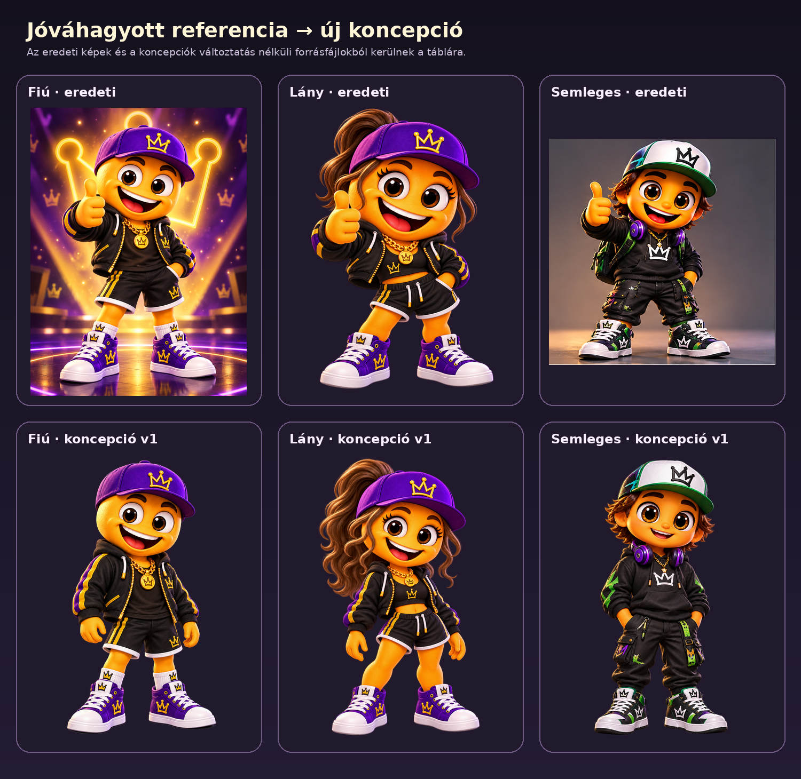
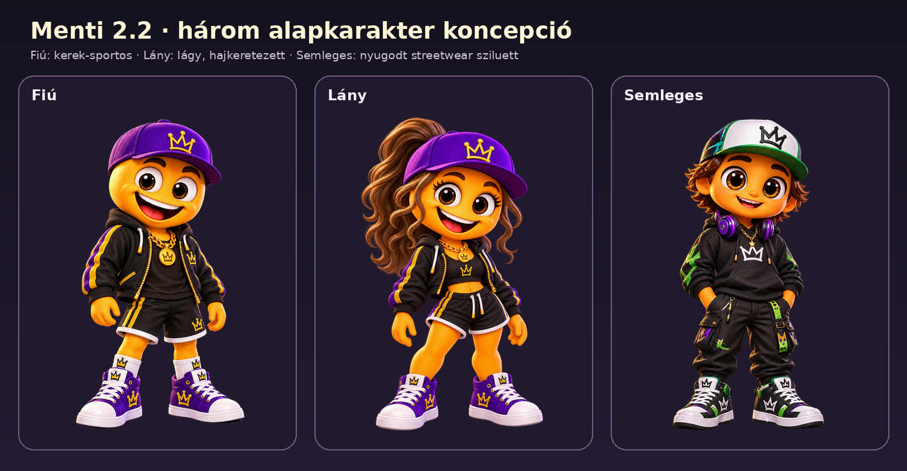

# Menti 2.2 – alapkarakter-koncepciók, vizuális jóváhagyási kapu

Ez a dokumentum kizárólag a teljes grafikai újratervezés első, vizuális
koncepciófázisát rögzíti. A három kép még nem került be az alkalmazás
rendererébe. A 115 opció, a Studio, a profilok, a migráció, a feloldások és a
backup/restore kódja ebben a fázisban változatlan.

## Elsődleges referenciák

A felhasználó által átadott három fájl az elsődleges vizuális forrás. Ezek nem a
korábbi 2.2-es SVG- vagy raster-generátor termékei. Az archívumból bitmódosítás
nélkül kerültek a repóba:

| Szerep | Fájl | Méret | SHA-256 |
| --- | --- | ---: | --- |
| klasszikus Fiú | `references/01-classic-approved.png` | 1086×1448 | `9e293428484bb127e018f9f7230b2585170211549482f4789271ff021f720eb0` |
| Lány | `references/02-girl-approved.png` | 1086×1448 | `c7f2ca009962fb2f654e6a2ded5287414e943c5894dfae4f010938cce9f0dc3f` |
| fiatalos utcai | `references/03-street-approved.png` | 512×512 | `d2e58dc4da85d17649d573f233be8de2465e1a58672cc924f4b0734542ef4a49` |



## A három v1 koncepció



Mindhárom koncepció 1122×1402 pixeles, átlátszó hátterű PNG. A nyugodt,
teljes alakos alapállás szándékos: a fej, törzs, kar, láb és cipő aránya így
közvetlenül összevethető, és később alkalmasabb a rétegek illesztési pontjainak
megtervezésére. Ezek grafikai checkpointok, nem alkalmazásképernyők és nem
állítják, hogy a teljes réteges rendszer már elkészült.

### Fiú

- Kerekebb, sportos fej- és vállsziluett, stabil kétlábas állás.
- A fej tervezési célja a teljes magasság körülbelül 38%-a; a törzs és a lábak
  kaptak elegendő helyet, a cipők nem nyomják össze a testet.
- A klasszikus lila koronás sapka, barna szem, fekete–arany anyagvilág és lila
  cipő közvetlenül őrzi az eredeti karakterazonosságot.
- A kéz kisebb és nyugalmi helyzetű, ezért nem torzítja a teljes sziluettet.

### Lány

- Lágyabb, enyhén szív/ovális arc, keskenyebb vállvonal és hosszú, hullámos
  barna haj ad önálló sziluettet.
- A fej tervezési célja körülbelül 37%, a lábaké körülbelül 29%; a karakter nem
  pusztán a Fiú hajjal ellátott változata.
- Az eredeti lila sapka és fekete–arany–lila öltözék megmarad, a crop top és a
  szabás saját divatos családidentitást ad.
- A haj tömege külön illesztési és takarási réteget igényel majd a végleges
  rendszerben.

### Semleges

- Szélesebb, nyugodt arc, kompaktabb téglalap-szerű streetwear törzs és
  egyenesebb állás különíti el a másik két családtól.
- A fej tervezési célja körülbelül 34%, a lábaké körülbelül 30%; ez a
  legnyúlánkabb, de továbbra is lekerekített Menti-sziluett.
- A fehér–zöld sapka, lila fejhallgató, fekete–zöld ruha és cargo nadrág az
  eredeti utcai referencia fő motívumait őrzi.
- A nyitottabb Menti-mosoly és nagyobb barna szemek korrigálják az első, túl
  emberi arcváltozatot.

## Közös arány- és minőségi szabályok

- A fej egyik családnál sem nyomhatja össze a törzset és a lábakat.
- A kar természetes nyugalmi hossza a felső comb környékéig tart; a kéz nem
  lehet a teljes fejjel versengő méretű.
- Mindkét cipő teljes egészében látható, azonos talajvonalon áll és nem lehet
  aránytalan fókuszelem.
- A szemek barna írisze, az orange Menti-bőr, a korona motívum és a lekerekített
  kabalaforma közös fajazonosságot ad.
- A családok különbségét az arcforma, hajtömeg, váll–törzs sziluett, lábhossz,
  állás és ruhaszabás együtt adja, nem egyetlen szín vagy kiegészítő.
- A fény bal-felső főfényből, finom peremfényből és anyagspecifikus csúcsfényből
  épül; a haj, textil, bőr és cipő eltérő felületi választ kap.

## Grafikai rendszerre vonatkozó döntési javaslat

A jelenlegi egyszerű SVG/raster rétegkészlet önmagában nem tudja megtartani a
referenciák hajrészletét, ruharedőit, anyagfényét és térfogatát. Jóváhagyás után
egy közös 4:5 artboardra épülő, nagy felbontású 2D material-rétegrendszert
érdemes készíteni:

1. családonként és korosztályonként külön test- és fejmaster;
2. külön előtér/háttér haj- és fejfedőrétegek;
3. családonkénti fej-, szem-, száj-, törzs-, kéz- és láb anchorok;
4. takarómaszkok a haj, sapka, kéz, ruha és kiegészítők helyes z-sorrendjéhez;
5. előrenderelt, nagy felbontású material PNG/WebP rétegek egységes fényiránnyal;
6. a meglévő 115 stabil opcióazonosító változatlan leképezése az új assetekre.

Ez továbbra is prémium 2D, térhatású grafika lenne, nem valódi 3D modell. A
végleges pipeline csak a három karakter vizuális jóváhagyása után készülhet el.

## Reprodukálás és regresszió

Az összehasonlító táblák a forrásképek újragenerálása nélkül készülnek:

```bash
python3 tool/render_menti_concept_evidence.py
flutter test test/menti_concept_assets_test.dart
```

A teszt mindhárom referencia, mindhárom koncepció és a két összehasonlító tábla
méretét, bájthosszát és CRC32 értékét ellenőrzi. Így egy véletlen képcsere vagy
újratömörítés látható regresszióként jelentkezik.

## Jóváhagyási pont

A következő fázis csak kifejezett felhasználói vizuális jóváhagyás után indul:
a három család három korosztályának elkészítése, majd a 115 opcióhoz tartozó
ruhák, hajak, arcok, fejfedők és kiegészítők újragyártása és illesztése. A zöld
CI a fájlok és az alkalmazás technikai állapotát igazolja, a grafikai minőség
elfogadását nem.
