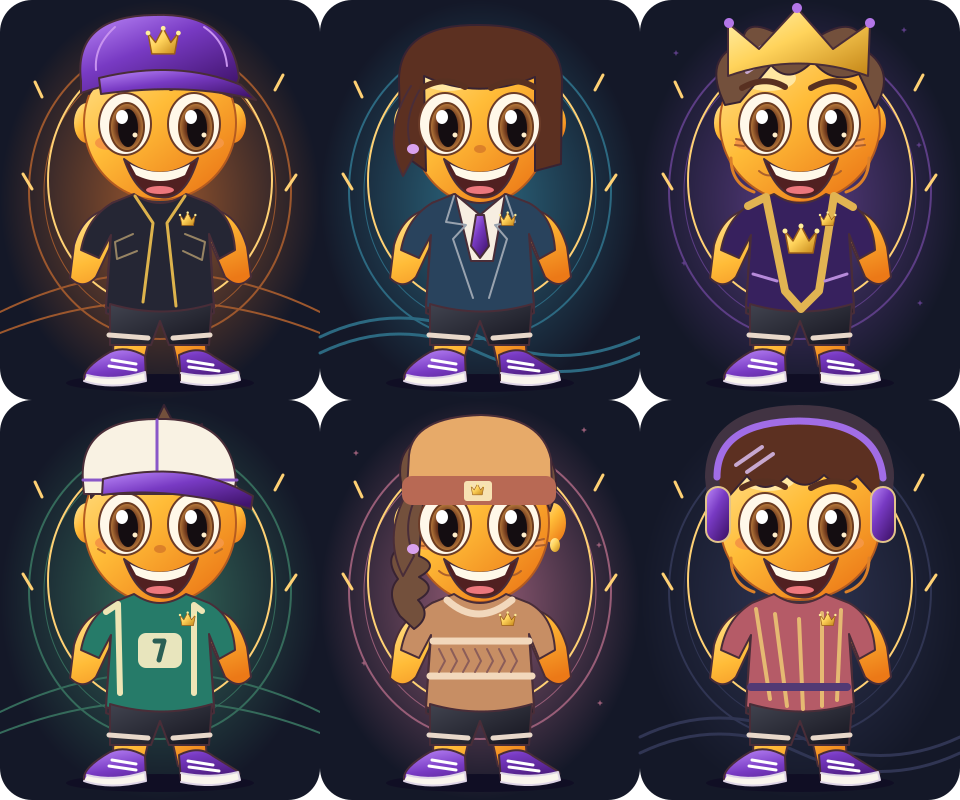

# Menti Studio 2.2 – B/C munkacsomag

Új, hat részes szerkesztő: alapok, arc/fej, ruházat, kiegészítők,
hangulat és presetek. Nagy élő előnézet, vízszintes illusztrált opciókártyák,
telefonon egymás alatti, 760 px felett kétoszlopos elrendezés.
Nagy betűnél a hosszú címkék tördelnek, az előnézet és a választók görgethetők.

115 opció, külön SVG-rétegek és saját előnézetek. Családonként hat hajforma,
tíz fejfedő, tíz ruhakategória két-két variánssal, hat háttér, hat aura,
hat színkiemelés és hét vizuális reakció. A család és kor együtt kilenc
külön alaprajzot használ. A kombinációk nem külön képfájlok.
Részletes név/szint/asset lista: `2.2-menti-asset-catalog-hu.md`.

A közös renderer determinisztikus rétegsorrendje: háttér, aura, hátidísz,
család/kor alap, ruha, stílusjel, színkiemelés, haj, arc, szem, arcdísz,
nyakdísz, fejfedő, szemüveg, kézi tárgy, reakció. Az ismeretlen ID ismert
rétegre esik vissza, a tárolt érték változatlan marad. RepaintBoundary és
flutter_svg cache, nincs kombinációnként új asset és nincs folyamatos animáció.
A sapka természetesen takarja a frizura felső részét.

A régi `AvatarPage` navigáció a Studio új felületére mutat. A régi mentési
kulcsokat nem töröljük és nem írjuk át. A teljes alkalmazás közös scope-hoz
kötése a D csomag feladata; ebben a szakaszban a Studio önálló controllerrel is fut.

Mentés: a teljes szerkesztési dokumentum egyszerre kerül a store-ba. Revert a
legutóbb sikeresen mentett állapotot állítja vissza, Alap Menti csak a kinézetet
állítja alapra (név, presetek és feloldások megmaradnak). Véletlen Menti csak
elérhető opciókból választ, a haj a kiválasztott családhoz igazodik. Kilépéskor
nem mentett módosítás esetén elvetési megerősítés jelenik meg.

Névvel mentett preset: a gomb a teljes aktuális összeállítást elmenti. Kedvenc és
másolat a következő Mentéssel rögzül; ezt a felület jelzi. Maximum 100 preset.
A preset ismeretlen mezői megmaradnak. Másolat új azonosítót kap.

XP-t a Studio csak a meglévő aktuális dokumentumból olvas. Nincs pontadás,
XP-migráció vagy kozmetikáért járó XP. A korábban megszerzett ruhák megmaradnak,
az új szintalapú kozmetikák a profil kifejezett mentésekor állandósulnak.
Sérült XP esetén a már tárolt feloldások és alapopciók elérhetők; a felület jelzi
a problémát. Az újonnan megszerzett címke a meg nem tekintett szintjutalmakat jelöli.

Minden új címke és opció HU/EN ARB-be került; a generátor ugyanabból az
opcióforrásból készíti a típussal ellenőrzött lokalizációs kapcsolást és a képeket.

Kézi ellenőrzés: 320/360/390 px, web széles nézet, 200% betűméret; HU/EN;
család/kor/haj fejfedő nélkül; több kiegészítő egyszerre; random/save/reopen;
preset/favorite/duplicate/revert; nem mentett kilépés; hibás profil; szintjutalmak.
A vektoros rajzok művészeti finomítása később folytatható a renderer cseréje nélkül.

## Vizuális példa

A kép a tényleges SVG-rétegek összeállítása, nem képernyőfotó. A Studio azonos
rétegeket használ. A stílus választása megfelelő elérhető ruhát is beállít;
a ruha utána önállóan változtatható.

## Igazolt B/C ellenőrzés

Implementációs HEAD: `69810ef57068c128cc70b9a1398a9a31bb428cdc`.
Teljes sikeres CI: https://github.com/hunyakferenc-droid/mennyiment/actions/runs/41295726162

Minden lépés sikeres: függőségzár ellenőrzése/pub get/gen-l10n, whitespace,
flutter analyze (No issues found), teljes flutter test, Europe/Budapest
backup/restore/DST regressziók és flutter build web.
Az új tesztfájlokban 74 domain/migrációs és 17 vizuális/Studio teszteset futott.
Ez az automata ellenőrzés, nem valós telefonos vagy képernyőolvasós kézi próba.
A dokumentációt rögzítő következő HEAD CI-je a #25 PR végső leírásában található.

Ág: `feature/mennyiment-2-2-studio`; draft PR: https://github.com/hunyakferenc-droid/mennyiment/pull/25
A #24 ágára épül, a teljes alkalmazásintegráció a #26-ban található.

A korábbi CI-hibák javításai: párbeszédablak zárójele és analyzer-nullability;
legacy Studio háttérkulcs bevonása és valódi színjelentése; egymástól eltérő
navigáció/editor widgetkulcsok; a régi PNG-választó helyett az új réteges mentés
ellenőrzése. A feloldásteszt kimutatta, hogy hiányzó legacy outfitből nem szabad
igazolt múltbeli jutalmat gyártani: a store csak ténylegesen tárolt ruhát és
jutalom-ID-t importál. XP-logika és jutalomszintek nem lazultak.
