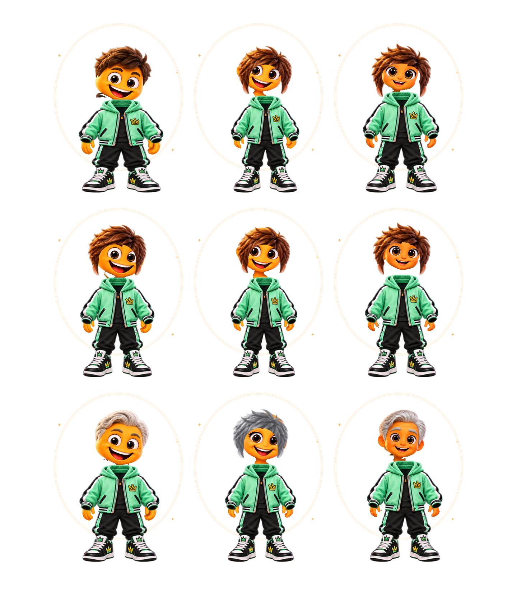
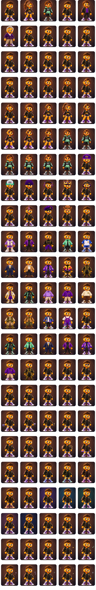

# MennyiMent? 2.2.1 – Visual Revolution & Mobile UX

Fejlesztési állapot: **folyamatban**. Ez checkpoint-jelentés, nem végleges grafikai elfogadás.

## Biztos fejlesztési alap

PR #32 távoli HEAD ellenőrizve: `82da3476033881c36b32b3e906802cc7dadbe378`.
Új ág: `feature/mennyiment-2-2-1-visual-ux`. Célág: `feature/mennyiment-2-2-final-playable`.
Nem történt main-módosítás, merge, release vagy publikálás.

## A – Referenciák és a minőségvesztés oka

A felhasználó most csatolt három korosztályos képei már rendelkezésre állnak:

- Fiú: `docs/images/menti-final-playable/boy-ages.png`.
- Lány: `docs/images/menti-final-playable/girl-ages.png`.
- Semleges: `docs/images/menti-final-playable/neutral-ages.png`.

Mindhárom 1942×809, RGBA. Ezek változatlan másolatai kerültek az alkalmazás
`assets/images/menti_2_2/reference/` könyvtárába. Az eredeti fájlok változatlanok;
a pontos SHA-256, bájthossz és méret a `test/fixtures/menti_reference_sources.json` fájlban van.
A #30 három eredeti referenciája és három v1 koncepciója szintén rendelkezésre áll,
és változatlan. Nincs hiányzó, újra bekérendő eredeti referencia.

**A korábbi hiba oka:** a 2.2 a jó minőségű három korosztályos lapokat dokumentációként
őrizte, a futó karaktert viszont más, kisebb atlaszok általános testéből, szeméből,
szájából, hajából és közös ruhaszettjeiből szerelte össze. A családonkénti szélességállítás
nem őrizte meg a saját arcokat, szempillákat, aszimmetrikus mimikát és ruhasziluettet.
Az egymástól független elemek nyújtása és az általános maszkok tovább módosították az arányokat.

**A javítás alapja:** 9 regisztrált, teljes alakos forráskarakter. Az alapmegjelenés
az eredeti arcot, orrot, szemet, szájat, hajat, ruhát, kezet és cipőt együtt őrzi meg.
Egyenletes méretarány, változatlan talajvonal, külön arc-, szem-, száj- és nyakanchorok.
A korábbi atlaszrenderer csak reprodukálható előtte–utána bizonyítékként marad elérhető.

A Lány saját arcformáját, szempilláit, hajtömegét, test- és ruhasziluettjét kapja vissza.
A korosztályok a forráslapok tényleges eltérő arcait és haját használják.
A Semleges saját zöld streetwear forráslapjából renderelődik.

## Valódi képi bizonyíték – checkpoint A

Az alábbiak **Flutter runtime-renderek**, nem új generált koncepcióképek:

Újrafuttatás: `MENTI_CAPTURE=1 flutter test test/menti_reference_runtime_test.dart`.
A forráslapok nem tartalmaznak külön, eredetileg regisztrált 115 opcióréteget. Az önálló
atlaszelemek megvannak, de nem az eredeti kilenc mester pontos, külön exportált rétegei.
Ezt az eltérést nem szabad elkészült, referenciahű rétegkészletnek nevezni.

## Következő checkpointok

- B: 115 opció illesztése, szem/arc reakciók és natív haj/test megőrzése; valódi variációs ellenőrzés.
- C: mobil Studio, egyértelmű mentés/visszavonás, látható előnézet.
- D: fejléc, kezdőképernyő és navigáció.
- E: HU/EN × 320/360/390/430 × 1×/2× szöveg, adat- és animációregressziók.
- F: teljes teszt, Chrome, APK/web artifact, aláírás és ellenőrzőösszeg.

Checkpoint A: két új célzott teszt sikeres. A végleges teljes teszt- és builderedmény még nincs meg.
Fizikai Android-készüléken vagy emulátoron teszt nem történt.

## Checkpoint B – regisztrált testreszabás

A natív kilences készlet után következett a testreszabás. A hajcsere számára három
új, referencia alapján szerkesztett haj nélküli mesterlap készült; ezek **származtatott
új források**, nem a tulajdonos eredeti képei. A fájlok változatlan generált PNG-k,
pontos lenyomatuk a `test/fixtures/menti_reference_derivatives.json` fájlban van.
Ezek pótolják a forráson a haj mögött nem létező fejbőrt és vállrészeket.

- A hajcsere nem cseréli le az alapruhát egy általános ruhára.
- A hajrétegek megtartják saját képarányukat.
- A külön ruhákhoz az eredeti referencia saját kezei kerülnek, forráspixelből
  számított kontúrral, a mandzsetta mögé.
- Az arc- és szemopciók a család saját szemét, szempilláit és száját deformálják
  folytonos hálóval; nincs idegen közös atlaszarc vagy szögletes bőrráfestés.
- A színkiemelés ruhamaszkra korlátozódik; az eredeti kéz és láb bőre megmarad.
- A családválasztáskor az életkornak megfelelő natív haj lesz az új előnézet alapja;
  a már elmentett profil betöltése semmit nem ír át.
- Az app csak a ténylegesen szükséges PNG-ket várja meg az adott karakterhez;
  a dekódolt képek a Flutter közös gyorsítótárában maradnak.

Ellenőrzés: a kilenc natív arc belső, átlátszatlan pixelterülete közvetlenül
összehasonlítva az eredeti forrásréteggel, eltérés nélkül. A 115 opcióra és kilenc
karakterre futó meglévő pixelkülönbség-teszt is sikeres. Ez technikai bizonyíték;
a teljes opciókészlet esztétikai elfogadását nem jelenti.

## Checkpoint C – mobil Studio

- Külön, görgetéstől független mentési és visszavonási sáv, safe area-val.
- A nem mentett állapot külön jelzést kap; visszalépéskor megerősítő ablak véd.
- Az előnézet nem az opciólista hosszú bevezetője: külön panel, külön összecsukó gombbal.
- A kategóriák vízszintesen görgethetők; az opciók címkéi több sorba törhetnek.
- A véletlen választás és visszaállítás másodlagos menübe került.
- A becenév szerkesztése és a presetek megmaradtak.
- Kétszeres szövegméretnél a két mentési művelet egymás alá rendeződik.

16 új funkcionális mobilteszt: HU/EN × 320/360/390/430 px × 1×/2×, 740 px
magasságon. Minden esetben elérhető mentés/visszavonás, visszalépési védelem,
csak-előnézet kontra mentett profil, sikeres mentés, kedvenc preset és ismeretlen
mezők megőrzése, változatlan XP és napló. A teljes tesztcsomag újrafuttatása folyamatban.

## Checkpoint D – kezdőlap és navigáció

A saját Menti kártyája előre került; a naplózás a kártya után következik.
A másodlagos funkciók a „További funkciók” csoportban maradnak elérhetők;
a csoport kinyitott állapota görgetés és lista-újraépítés után is megmarad.
A napló, statisztikák, célok, kihívások, pénzügyek és heti jelentés útvonalai megmaradtak.
A fejlécben a teljes alkalmazásnév kap helyet; a profil, backup és beállítások
másodlagos menübe kerültek, külön nyelvválasztó mellett.

Közös `MentiDesign` téma: meglévő Menti-színpaletta, kártya- és gombformák,
egységes beviteli keretek, legalább 48 px gomb- és ikonérintési felületek.
Az egységesítés nem módosította a tárolási sémát vagy az adatfolyamatokat.

A navigáció, mozgás, nyelvváltás és profilszerkesztés 76 célzott tesztje sikeres.
A tesztek az új menün és kinyitható csoporton keresztül járják végig az eredeti
funkciókat; a név mentésének modális gombját külön kezelik az állandó Studio-mentéstől.

## Checkpoint E – lokalizáció és regresszió

A meglévő hat mély funkcióoldal tesztje a 320/360/390/430 px mobilméretekre és
1024 px asztali nézetre is kiterjed, HU/EN nyelven, 1×/2× szöveggel, végiggörgetve.
A teljes új felhasználói onboarding mind a négy mobilméreten fut mindkét nyelven és
szövegmérettel; a kiskorú tiltás és újraindítás utáni profil is ellenőrzött.
Az animációk továbbra is rövidek, nem módosítanak profilt vagy XP-t, és tiszteletben
tartják a csökkentett mozgás / háttér / eltakart útvonal állapotokat.
A Chrome-ellenőrzés külön, 2.2.1-es reprodukáló parancsfájlt kapott.
