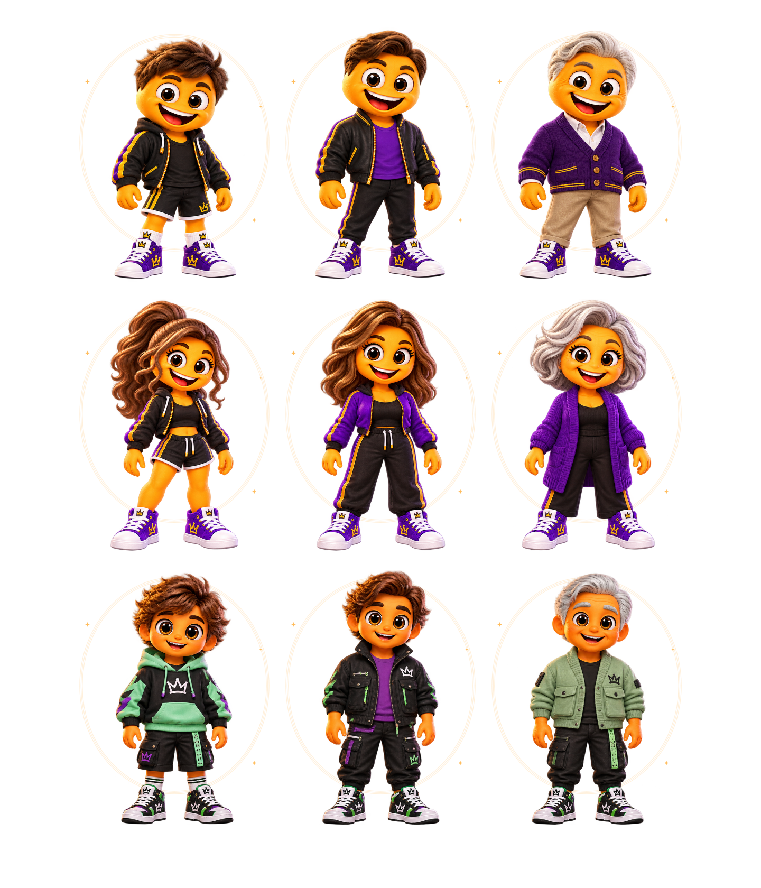
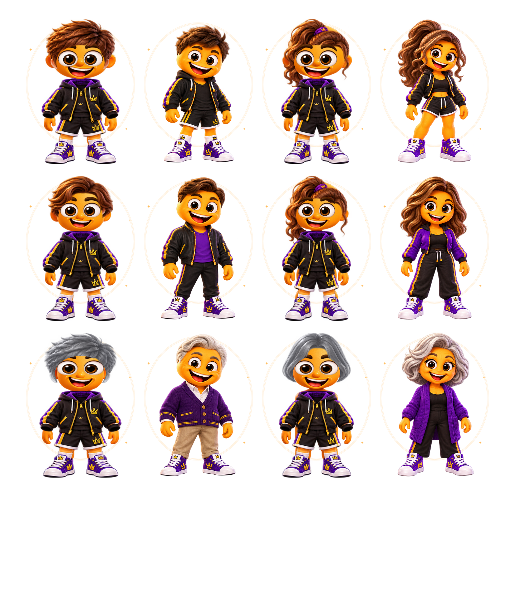
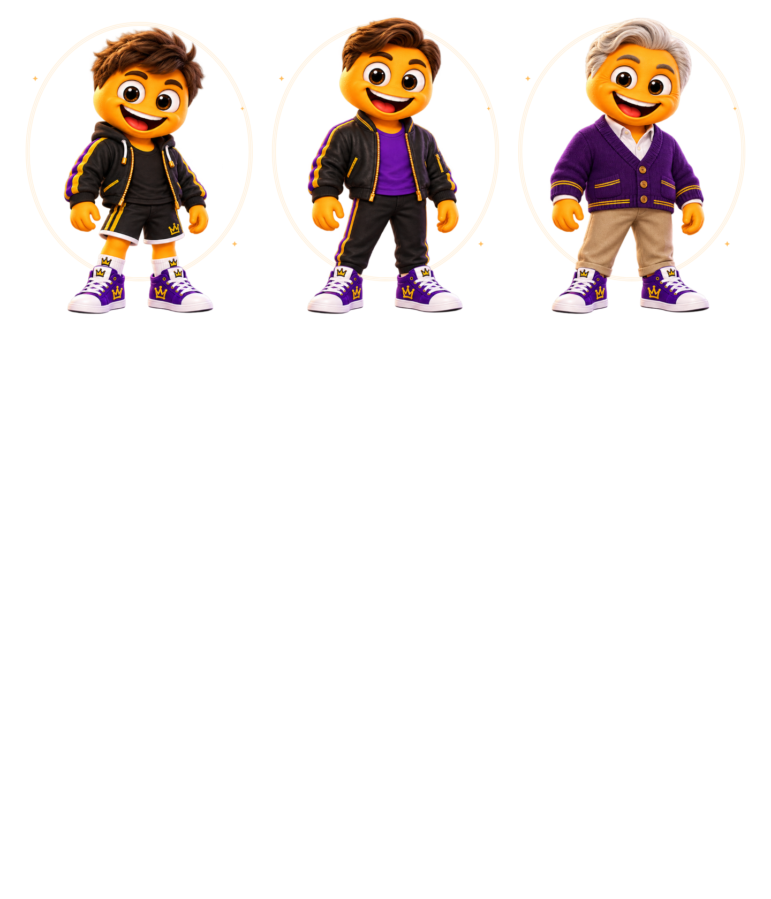
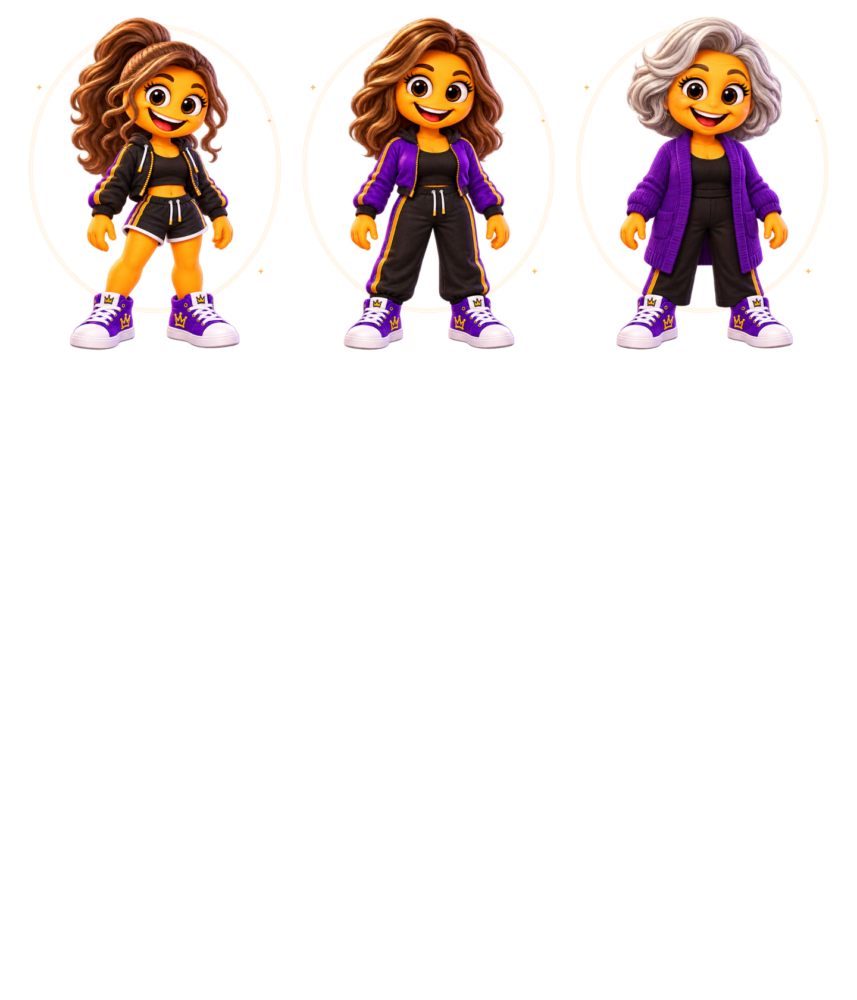
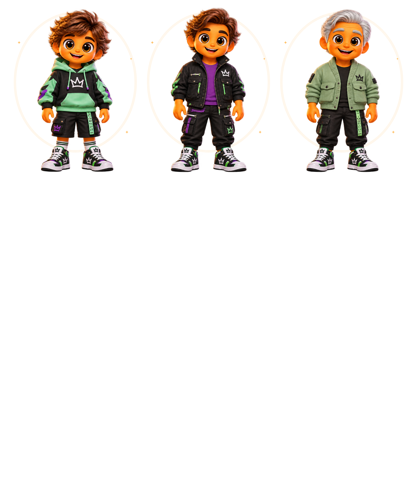
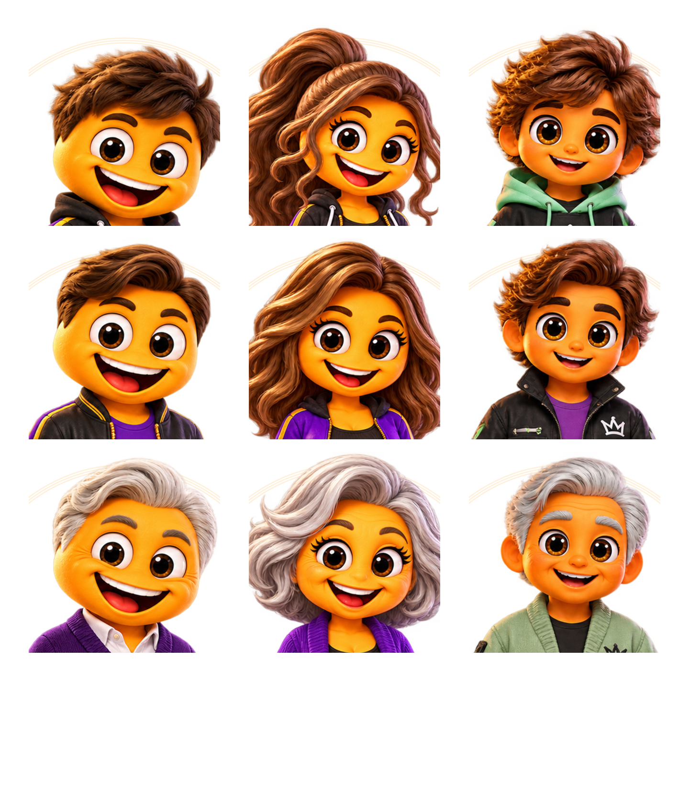

# MennyiMent? 2.2.1 – Visual Revolution & Mobile UX

Fejlesztési állapot: **folyamatban**. Ez checkpoint-jelentés, nem végleges grafikai elfogadás.

## Biztos fejlesztési alap

PR #32 távoli HEAD ellenőrizve: `82da3476033881c36b32b3e906802cc7dadbe378`.
Új ág: `feature/mennyiment-2-2-1-visual-ux`. Célág: `feature/mennyiment-2-2-final-playable`.
Nem történt main-módosítás, merge, release vagy publikálás.

## A – Referenciák és a minőségvesztés oka

A felhasználó most csatolt három korosztályos képei már rendelkezésre állnak:

- Fiú: `docs/images/menti-final-playable/boy-ages.png`.
- Lány: `docs/images/menti-final-playable/girl-ages.png`.
- Semleges: `docs/images/menti-final-playable/neutral-ages.png`.

Mindhárom 1942×809, RGBA. Ezek változatlan másolatai kerültek az alkalmazás
`assets/images/menti_2_2/reference/` könyvtárába. Az eredeti fájlok változatlanok;
a pontos SHA-256, bájthossz és méret a `test/fixtures/menti_reference_sources.json` fájlban van.
A #30 három eredeti referenciája és három v1 koncepciója szintén rendelkezésre áll,
és változatlan. Nincs hiányzó, újra bekérendő eredeti referencia.

**A korábbi hiba oka:** a 2.2 a jó minőségű három korosztályos lapokat dokumentációként
őrizte, a futó karaktert viszont más, kisebb atlaszok általános testéből, szeméből,
szájából, hajából és közös ruhaszettjeiből szerelte össze. A családonkénti szélességállítás
nem őrizte meg a saját arcokat, szempillákat, aszimmetrikus mimikát és ruhasziluettet.
Az egymástól független elemek nyújtása és az általános maszkok tovább módosították az arányokat.

**A javítás alapja:** 9 regisztrált, teljes alakos forráskarakter. Az alapmegjelenés
az eredeti arcot, orrot, szemet, szájat, hajat, ruhát, kezet és cipőt együtt őrzi meg.
Egyenletes méretarány, változatlan talajvonal, külön arc-, szem-, száj- és nyakanchorok.
A korábbi atlaszrenderer csak reprodukálható előtte–utána bizonyítékként marad elérhető.

A Lány saját arcformáját, szempilláit, hajtömegét, test- és ruhasziluettjét kapja vissza.
A korosztályok a forráslapok tényleges eltérő arcait és haját használják.
A Semleges saját zöld streetwear forráslapjából renderelődik.

## Valódi képi bizonyíték – checkpoint A

Az alábbiak **Flutter runtime-renderek**, nem új generált koncepcióképek:

Újrafuttatás: `MENTI_CAPTURE=1 flutter test test/menti_reference_runtime_test.dart`.
A forráslapok nem tartalmaznak külön, eredetileg regisztrált 115 opcióréteget. Az önálló
atlaszelemek megvannak, de nem az eredeti kilenc mester pontos, külön exportált rétegei.
Ezt az eltérést nem szabad elkészült, referenciahű rétegkészletnek nevezni.

## Következő checkpointok

- B: 115 opció illesztése, szem/arc reakciók és natív haj/test megőrzése; valódi variációs ellenőrzés.
- C: mobil Studio, egyértelmű mentés/visszavonás, látható előnézet.
- D: fejléc, kezdőképernyő és navigáció.
- E: HU/EN × 320/360/390/430 × 1×/2× szöveg, adat- és animációregressziók.
- F: teljes teszt, Chrome, APK/web artifact, aláírás és ellenőrzőösszeg.

Checkpoint A: két új célzott teszt sikeres. A végleges teljes teszt- és builderedmény még nincs meg.
Fizikai Android-készüléken vagy emulátoron teszt nem történt.
