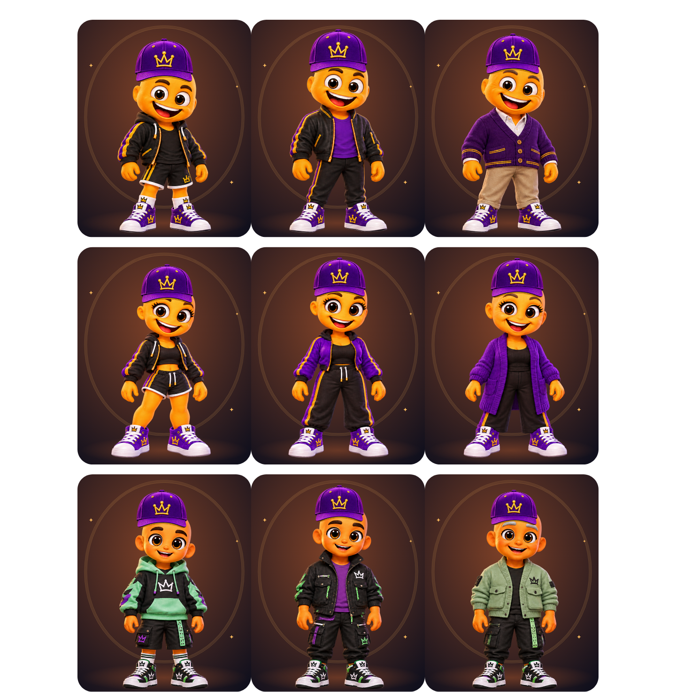

# MennyiMent? 2.2.2 – geometriai és vizuális finomítás

Állapot: a funkcionális javítás, teljes teszt, Chrome-próba és CI artifact-ellenőrzés elkészült.
A meglévő draft PR #33 és a `feature/mennyiment-2-2-1-visual-ux` ág frissül, main-merge nélkül.
Kiindulás: ellenőrzött távoli `66894bfbece48938dd3c77b9792553f0e5b35fec` (2.2.1).

## Konkrét okok és javítás

1. A régi szem- és szájterületek részben átfedtek, és a hajas / haj nélküli
   mesterek ugyanazokat az anchorokat kapták. Külön forráspixelből mért szem- és
   szájkoordináták készültek; a száj nem írhat a szem területére.
2. A nagy, forgatással kombinált hálódeformációk helyett rögzített szélű,
   kis helyi változások maradtak. Az alkalmazott háromszögek pozitív irányúak;
   a fej- és testkontúr nem része a mimika deformációjának.
3. Az összes haj ugyanarra a meglévő, részletes haj nélküli család/kor szerinti
   forrásfejre kerül. A frizuraváltás nem cseréli ki az arcot és a koponyát.
   Ez a 2.2.1-es renderer célzott pontosítása, új grafikai rendszer és újragenerált
   karakterek nélkül. Az eredeti referencia- és mesterfájlok változatlanok.
4. A sapka kilenc külön család/kor illesztést és hat hajtípushoz tartozó korrekciót
   használ. A mérete kisebb, a PNG képaránya megmarad, az alsó széle a szem fölött marad.
   A haj a sapka felső részénél alá kerül; az arcvédő maszk a tényleges szemekhez igazodik.
5. Új felhasználónál és kifejezett alaphelyzetbe állításkor a haj kikapcsolt.
   A Studio külön hajkapcsolót kapott; frizura választása bekapcsolja.
   A 115 azonosító megmaradt. A `hairVisible` opcionális profilmező hiánya a régi,
   látható haj megőrzését jelenti. Nincs automatikus profilátírás vagy migráció.

## Valódi Flutter-képek

- Fiú: [sapkával/nélküle](images/menti-2.2.2/boy-cap-pairs.png), [haj](images/menti-2.2.2/boy-hair.png), [arc](images/menti-2.2.2/boy-expressions.png), [szem](images/menti-2.2.2/boy-eyes.png).
- Lány: [sapkával/nélküle](images/menti-2.2.2/girl-cap-pairs.png), [haj](images/menti-2.2.2/girl-hair.png), [arc](images/menti-2.2.2/girl-expressions.png), [szem](images/menti-2.2.2/girl-eyes.png).
- Semleges: [sapkával/nélküle](images/menti-2.2.2/neutral-cap-pairs.png), [haj](images/menti-2.2.2/neutral-hair.png), [arc](images/menti-2.2.2/neutral-expressions.png), [szem](images/menti-2.2.2/neutral-eyes.png).

Ezek tényleges Flutter runtime-renderek, nem koncepcióképek. A korábbi 2.2.1
képi bizonyítékai az előző dokumentációban változatlanul megmaradtak.

## Végleges ellenőrzések

- 1296 család × kor × haj × arc × szem kombinációban a mimika támogatási területén
  kívüli pixelek változatlanok; nincs mozgó fejkontúr vagy széteső test.
- 486 család/kor/haj/fejfedő kombinációban a szemterület nem takaródik el.
- Minden tényleges deformációs háló minden háromszöge pozitív irányú, és a szélpontok rögzítettek.
- Régi profil betöltése nem ír adatot; hajkapcsoló mentés/visszavonás, presetek és ismeretlen mezők megmaradnak.
- A 16 HU/EN × 320/360/390/430 × 1×/2× mobil Studio-folyamat sikeres az új hajkapcsolóval is.
- A végleges helyi teljes tesztcsomag: **634 sikeres / 1 időzóna-kihagyás**. A CI külön Europe/Budapest ellenőrzése is sikeres.

## Böngészős Studio és előtte–utána

Az összehasonlítások nyers runtime-képek. A 2.2.1 állapota hajas alapot, a 2.2.2 új alapja kikapcsolt hajat mutat; ez szándékos default-változás, nem azonos beállításokkal végzett pixelteszt.

| Állapot | 2.2.1 | 2.2.2 |
|---|---|---|
| HU 320 px főképernyő | [előtte](images/menti-2.2.1/chrome-home-native-hu-320.png) | [utána](images/menti-2.2.2/chrome-home-native-hu-320.png) |
| Mobil Studio | [előtte](images/menti-2.2.1/chrome-studio-mobile-en.png) | [utána](images/menti-2.2.2/chrome-studio-mobile-en.png) |
| Szemválasztás | [előtte](images/menti-2.2.1/chrome-studio-eyes-en.png) | [utána](images/menti-2.2.2/chrome-studio-eyes-en.png) |

További tényleges Chrome-képek: [nagy előnézet](images/menti-2.2.2/chrome-studio-zoom-en.png), [haj](images/menti-2.2.2/chrome-studio-hair-en.png), [arc](images/menti-2.2.2/chrome-studio-face-en.png), [sapka nélkül](images/menti-2.2.2/chrome-studio-no-cap-en.png), [HU 320 px Studio](images/menti-2.2.2/chrome-studio-hu-320.png), [asztali Studio](images/menti-2.2.2/chrome-studio-desktop-en.png), [régi profil](images/menti-2.2.2/chrome-existing-profile-en.png).

A Chrome-próba mentést, visszavonást, újratöltést, régi profil írás nélküli betöltését, HU/EN felületet és fiatalkorú korlátozását ellenőrizte. Runtime-hiba és navigációs megszakítás: **0**. [Gépi eredmény](images/menti-2.2.2/chrome-verification.json).
A kártyák, Studio és nagy előnézet ugyanazt a renderer-geometriát használják.

## Build és letöltés

Verzió: **2.2.2+24**, változatlan csomagazonosító: `com.example.mennyiment`.
Ellenőrzött alkalmazásforrás: `70fbf8d648f029af8750cb3d3fef4cc18eef4201`.
Az utána következő bizonyíték/dokumentáció commit nem módosítja az alkalmazás forrását.

[GitHub Actions – sikeres teljes futás](https://github.com/hunyakferenc-droid/mennyiment/actions/runs/41472162200).
Mind a hat kért lépés sikeres: `flutter pub get`, `flutter gen-l10n`, `flutter analyze`, `flutter test --concurrency=2`, `flutter build web`, `flutter build apk --debug`.

- [Android debug APK ZIP](https://github.com/hunyakferenc-droid/mennyiment/actions/runs/41472162200/artifacts/13156631189) – APK, SHA-256 és build-info.
- [Web build ZIP](https://github.com/hunyakferenc-droid/mennyiment/actions/runs/41472162200/artifacts/13156475649).
- [Ellenőrzési adatok](images/menti-2.2.2/build-verification.json).

Mindkét letöltött ZIP CRC-ellenőrzése sikeres; SHA-256 értékük egyezik a GitHub artifact digesttel. Az APK tartalmi hash egyezik a mellékelt checksum-fájllal. V2 aláírás ellenőrzött; min SDK 24, target SDK 36.

## Korlátok és adatvédelem

A fejkontúr stabilitása mért, a mimika szándékosan visszafogottabb. A meglévő ruharétegek grafikai korlátai változatlanok; a tesztek nem helyettesítik a tulajdonosi vizuális elfogadást, és nem jelentik az összes lehetséges ruhakombináció művészi jóváhagyását.

A 115 opcióazonosító változatlan. A profilok, presetek, kedvencek, mentés/visszaállítás, backup/restore, ismeretlen mezők, XP, korhatár és HU/EN viselkedés regressziós tesztjei sikeresek. A régi dokumentumok hiányzó hajkapcsolója látható hajat jelent; nincs automatikus adatátírás, kulcs- vagy sémamigráció.

**Fizikai Android- és emulátoros futtatás nem történt.** A CI debug tanúsítványa eltér az előző 2.2.1 csomagétól, ezért arra a meglévő telepítésre közvetlen frissítés nem lehetséges ezzel az aláírással. Adatmegőrző frissítéshez az eredeti aláírókulcs szükséges. A meglévő telepítést és adatait ne töröld; tesztelj külön eszközön, és tarts külső backupot. A build nem release-csomag; main-merge nem történt.

