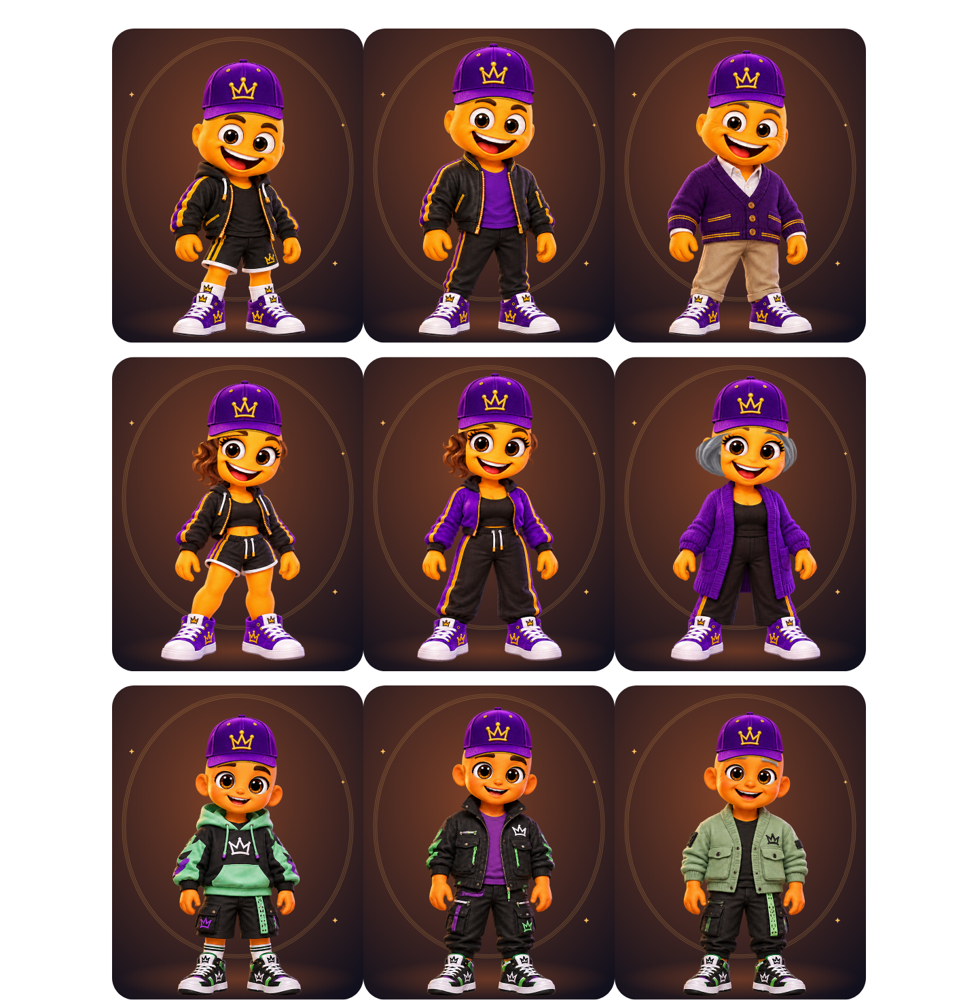

# MennyiMent? 2.2.3 – célzott végső finomítás

A 2.2.2-es referenciaalapú rendszer pontosítása; nincs új karaktergrafika vagy újratervezés. A 2.2.2-ben javított fej-, szem- és szájháló változatlan.

## Lány alapállapot

Új onboarding és a Lány család kifejezett kiválasztása látható, természetes alapfrizurát ad. Fiatalos/felnőttes korban `girl-waves`, veteránként `girl-bob` az onboarding alapja. A fiú és semleges friss alapállapot továbbra is letisztult. A haj továbbra is kikapcsolható.

A meglévő mentett profilok és presetek hajbeállítását nem írjuk át. A korábban elmentett, kikapcsolt hajú lány a hajkapcsolóval vagy a Lány család újraválasztásával kapja az új alapot; a változás mentésig csak draft. A hiányzó `hairVisible` mező továbbra is látható hajat jelent.

## Sapka

A korábbi füleket is befoglaló fejhatár közepe több családnál balra tért el a felső koponya középvonalától. A kilenc illesztés most a forrásképek felső koponyakontúrjához igazodik. Családonként/korosztályonként külön haj nélküli és hajas szélesség/ülésmagasság van, hat frizurakorrekcióval. A PNG képaránya megmarad, a sapka nem deformálja a fejet, alsó széle a szemek fölött marad.

A haj takarása a sapka átlátszó felső sarkaiban is elrejti a copfot/hajtetőt; a sima ívű maszk a sapka alatt megőrzi az oldalsó hajhosszt.

## Tényleges Flutter runtime-képek

| Család | Alapállapotok | Sapkával / nélkül | Hajjal / nélkül |
|---|---|---|---|
| Fiú | [3 kor](images/menti-2.2.3/boy-defaults.png) | [párok](images/menti-2.2.3/boy-cap-pairs.png) | [párok](images/menti-2.2.3/boy-hair-pairs.png) |
| Lány | [3 kor külön](images/menti-2.2.3/girl-defaults.png) | [párok](images/menti-2.2.3/girl-cap-pairs.png) | [párok](images/menti-2.2.3/girl-hair-pairs.png) |
| Semleges | [3 kor](images/menti-2.2.3/neutral-defaults.png) | [párok](images/menti-2.2.3/neutral-cap-pairs.png) | [párok](images/menti-2.2.3/neutral-hair-pairs.png) |

Előtte: [2.2.2 kilenc alapállapot](images/menti-2.2.2/default-nine.png). Utána: [2.2.3 kilenc alapállapot](images/menti-2.2.3/default-nine.png). Az új alapnál a lány hajkapcsolója szándékosan bekapcsolt; ez a default változásának bizonyítéka, nem azonos profilok pixeltesztje.

Mind a kilenc alap sapkás/sapka nélküli képét ténylegesen átnéztük. A tesztek nem jelentenek tulajdonosi művészi jóváhagyást.

## Adatvédelem és ellenőrzések

A 115 opcióazonosító és az eredeti referencia/mester PNG-k változatlanok. Nincs sémamigráció, profilbetöltéskor nincs automatikus átírás. A mentés/visszavonás és a kifejezetten kikapcsolt haj újratöltése regressziós tesztet kapott.

Új teszt közvetlenül a forrás PNG bőrpixeleinek felső kontúrjából méri a sapka középvonalát, mind a kilenc fejhez és hat frizurához, hajjal/nélkül. Az eltérés 1 renderer-pixel alatti. A korábbi 1296 kontúr-invariancia és 486 szemtakarási ellenőrzés megmaradt.

Verzió: **2.2.3+25**. A végleges teljes teszt, Chrome, web/APK artifact és aláírás eredménye a záró bizonyíték-commitban kerül ide. Fizikai Android-teszt nem történt. Draft PR #33 frissül, main-merge nélkül.
