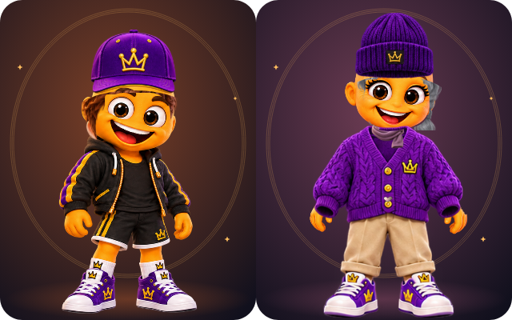
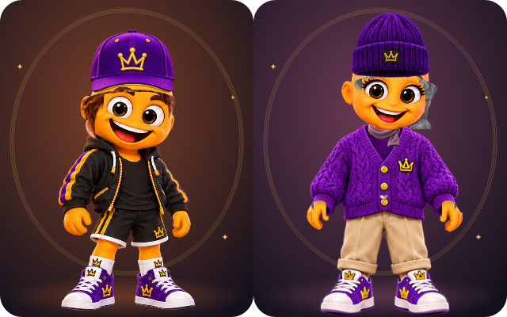

# MennyiMent? 2.2.6+29 – nyak–gallér javítási checkpoint

2026. november 11. A folytatás alapja a #36-os draft PR `26c6016` HEAD-je. A fejlesztési ág továbbra is `feature/mennyiment-2-2-6-naturalization`; a PR alapága változatlan. Alkalmazásforrás: `a656797`; a későbbi átadási commitok a jelentést, a bizonyítékot és a képcsomagot készítő munkafolyamatot adják hozzá; az alkalmazáskód változatlan.

## Mi változott?

A cserélhető ruhák atlasza ember nélküli gallérbelsőt tartalmazott: különösen az üzleti ingben szürke, más felsőkben sötét betét helyettesítette a nyakat. A 19 cserélhető ruha most saját, forráspixelben mért belső nyakkontúrt kap. A karakter eredeti nyakának bőrmintája ívelt maszkkal, oldalsó térformáló és áll alatti kontaktárnyékkal tölti ki ezt. A frontgallér, nyakkendő, varrás és díszítés megmarad. A huszadik, natív alapruha változatlan.

A kilenc karakter eredeti nyakrésze külön, ívelt állvonal mentén takart: az eredeti ruha fölötti nyak nem lóghat ki az új ing mellé. A fej egyetlen alkalommal kerül a nyak és a ruha fölé. Ez megszünteti a korábbi kísérlet kettős alfa-kompozitálását is. A szem és a száj eredeti renderpixeleit új regresszió védi.

A Studio élő szerkesztési előnézete stabil pózt használ, ahogy a kártyák és a nagyított nézet. A fő alkalmazás karakteranimációja megmarad. A mobilos Studio-teszt már a nagy és a normál nézet profiljának és animációs beállításának egyezését is ellenőrzi.

## Vizuális ellenőrzés

[Helyben megnyitható előtte–utána összehasonlító](images/menti-2.2.6-checkpoint/index.html). GitHubon a HTML forrásként látszik; a képek a mappákból közvetlenül is megnyithatók.

- 180 teljes ruha: 20 ruha × 9 alapkarakter, a korábbi audit változatlan profiljaival.
- 180 nyak–gallér közelkép oldalanként, azonos 98 × 89,8333 koordinátás kamerával.
- 180 összetett konfiguráció oldalanként: haj, sapka, kapucni, fejhallgató, szemüveg, sál, lánc, masni, könyv, virág és pálca együtt. Ez célzott mintavétel, nem a teljes Descartes-szorzat.
- 36 nagyított szemüveg/masni/sál konfiguráció oldalanként.
- A meglévő audit 927 kompatibilis opciót és 18 további összetett figurát is ténylegesen renderel.
- A meglévő páronkénti kombinációs készlet 200 sora mind a 9 rigben fut: 1800 renderelt konfiguráció, 1424 opciópár lefedésével.

Az előtte-képek külön, `26c6016` worktree-ben készültek. A két új képsor ugyanazt a `tool/menti_226_necks_test.dart` harnesszt használja; a részletképeket a meglévő `tool/menti_226_details_test.dart` készíti. A profil- és kameramanifestek páronként azonosak. A képeken nincs utólagos retusálás.

A golden-frissítés kizárólag a testreszabott pár szándékos nyak- és csuklóváltozását rögzíti: 1773 pixel változott a 640 × 400-as képen. A klasszikus fél teljes RGBA képpontsora változatlan. A két kilenckarakteres család-golden fájlja változatlan.

| Korábbi referencia | Ellenőrzött javítás |
| --- | --- |
| [](images/menti-2.2.6-checkpoint/golden-before.png) | [](images/menti-2.2.6-checkpoint/golden-after.png) |


A váll, mandzsetta, kéz és tárgy kapcsolatát a teljes ruhás és összetett képeken ellenőriztem. A korábbi ruhánkénti csukló- és képarány-geometria megmaradt. A feketével kitöltött mandzsettabelső most a szűk belső nyílásban átengedi az eredeti csuklómaszkot; ez megszünteti a kéz fölötti üres ujjbelsőt új kézgrafika vagy méretnövelés nélkül. A pixelregresszió mindkét csukló tényleges láthatóságát és a kézhez kapcsolódó, folytonos bőrfelületét is ellenőrzi. A nyílás alsó részében nem maradhat a csuklót megszakító fekete atlaszperem. A szemüveg, sál, lánc, masni és kézi tárgyak meglévő anyagai megmaradtak; ebben a checkpointban a nyakkörnyezet és a rétegzés javult. Nem készültek új ruhamesterek vagy új fogókéz-grafikák.

## Adat- és funkciómegőrzés

A kilenc natív alapkarakter assetje, a 115 opcióazonosító és fixture-jei, az identitás-adatmodell, a mentési és feloldási logika változatlan a `26c6016` forráshoz képest. A meglévő teszteket megtartottam. Nincs main merge, release, közzététel vagy felhasználói adattörlés.

## Lezárt technikai ellenőrzés

| Ellenőrzés | Eredmény |
| --- | --- |
| Teljes Flutter-tesztcsomag, Europe/Budapest | **651 sikeres, 0 hiba, 0 kihagyás** |
| Analyzer | **No issues found** |
| Páronkénti kombinációs ellenőrzés | **1800 renderelt konfiguráció, 1424 opciópár** |
| Nyak, két csukló, szem/száj pixelek | **180 ruha–karakter páros; 171 cserélhető felső két csuklójának folytonossága** |
| Friss webbuild | **2.2.6+29, sikeres** |
| Chromium 154, négy mobil/asztali nézet | **11 sikeres ellenőrzés, 0 runtime hiba, 0 navigációs megszakítás** |

A Chrome-próba a tényleges webbuilddel ellenőrzi a mentést és újratöltést, a draft visszavonását, a nagyított nézetet, régi profilokat, üzleti ing/masni mentés-fixture-t, magyar 320 px nézetet és a kiskorú-folyamatot. [Gépi jegyzőkönyv](images/menti-2.2.6-checkpoint/chrome/chrome-verification.json) · [Teljes ellenőrzési adatok](images/menti-2.2.6-checkpoint/verification.json) · [Flutter naplók](images/menti-2.2.6-checkpoint/logs/).

A [GitHub CI](https://github.com/hunyakferenc-droid/mennyiment/actions/runs/43075349502) analyzer-, teljes teszt- és webbuild-lépése szintén sikeres az `a656797` forráson. A korábbi CI-hiba a felülvizsgált testreszabott golden frissítésével megszűnt; a toleranciát nem lazítottam és tesztet nem hagytam ki.

A letöltött web ZIP CRC-je és GitHub API szerinti SHA-256 hash-e ellenőrzött. A 334 fájlból 333 bájtra egyezik a Chrome-ban kipróbált helyi builddel. A bootstrap csak JSON-sorrendben, egy használaton kívüli üres buildbejegyzésben és a service worker cache-verziójában tér el; normalizálva azonos. [Artifact-adatok és checksum](images/menti-2.2.6-checkpoint/web-artifact-verification.json).

A [letölthető képcsomag workflow-ja](https://github.com/hunyakferenc-droid/mennyiment/actions/workflows/checkpoint-evidence.yml) a képeket, az offline `index.html` összehasonlítót és ezt a magyar jelentést egyetlen ZIP-ben adja át. A képcsomag nem telepít és nem publikál alkalmazást.

## Kipróbálás laptopon

[Friss 2.2.6+29 web ZIP](https://github.com/hunyakferenc-droid/mennyiment/actions/runs/43075349502/artifacts/13880413686), alkalmazásforrás: `a656797`. GitHub-hozzáférés szükséges; megőrzés: 2026. november 25-ig. A teljes ZIP kibontása után az `index.html` mappájában indítsd: `python -m http.server 7357 --bind 127.0.0.1` (macOS/Linux alatt `python3`). Chrome-ban: `http://127.0.0.1:7357`. Python 3 szükséges; leállítás: Ctrl+C. A repository `tool/serve_menti_checkpoint.py` segédje ugyanezt a helyi kiszolgálást támogatja tetszőleges `--directory` mappából.

Forrásból:

```sh
git fetch origin feature/mennyiment-2-2-6-naturalization
git switch feature/mennyiment-2-2-6-naturalization
flutter pub get
flutter gen-l10n
flutter run -d chrome --web-port 7357
```

A korábbi böngészőmentés ugyanazon Chrome-profil, host és port használatával érhető el. Másik port más helyi tárhelyet jelent, az eredeti mentés megmarad. A ZIP-et HTTP-kiszolgálón keresztül kell megnyitni.

A checkpoint technikai és vizuális fejlesztői ellenőrzést kapott; a tulajdonosi laptopos művészeti elfogadás következő lépés. Fizikai Android-próba és publikálás nem része ennek az átadásnak.

## Képpárok mind a kilenc karakterhez

| Karakter | Nyak előtte | Nyak utána | Összetett előtte | Összetett utána |
| --- | --- | --- | --- | --- |
| Fiú / fiatal | [20 ruha](images/menti-2.2.6-checkpoint/necks-before/boy-young-necks.png) | [20 ruha](images/menti-2.2.6-checkpoint/necks-after/boy-young-necks.png) | [20 konfiguráció](images/menti-2.2.6-checkpoint/layered-before/boy-young-layered.png) | [20 konfiguráció](images/menti-2.2.6-checkpoint/layered-after/boy-young-layered.png) |
| Fiú / felnőtt | [20 ruha](images/menti-2.2.6-checkpoint/necks-before/boy-adult-necks.png) | [20 ruha](images/menti-2.2.6-checkpoint/necks-after/boy-adult-necks.png) | [20 konfiguráció](images/menti-2.2.6-checkpoint/layered-before/boy-adult-layered.png) | [20 konfiguráció](images/menti-2.2.6-checkpoint/layered-after/boy-adult-layered.png) |
| Fiú / veterán | [20 ruha](images/menti-2.2.6-checkpoint/necks-before/boy-veteran-necks.png) | [20 ruha](images/menti-2.2.6-checkpoint/necks-after/boy-veteran-necks.png) | [20 konfiguráció](images/menti-2.2.6-checkpoint/layered-before/boy-veteran-layered.png) | [20 konfiguráció](images/menti-2.2.6-checkpoint/layered-after/boy-veteran-layered.png) |
| Lány / fiatal | [20 ruha](images/menti-2.2.6-checkpoint/necks-before/girl-young-necks.png) | [20 ruha](images/menti-2.2.6-checkpoint/necks-after/girl-young-necks.png) | [20 konfiguráció](images/menti-2.2.6-checkpoint/layered-before/girl-young-layered.png) | [20 konfiguráció](images/menti-2.2.6-checkpoint/layered-after/girl-young-layered.png) |
| Lány / felnőtt | [20 ruha](images/menti-2.2.6-checkpoint/necks-before/girl-adult-necks.png) | [20 ruha](images/menti-2.2.6-checkpoint/necks-after/girl-adult-necks.png) | [20 konfiguráció](images/menti-2.2.6-checkpoint/layered-before/girl-adult-layered.png) | [20 konfiguráció](images/menti-2.2.6-checkpoint/layered-after/girl-adult-layered.png) |
| Lány / veterán | [20 ruha](images/menti-2.2.6-checkpoint/necks-before/girl-veteran-necks.png) | [20 ruha](images/menti-2.2.6-checkpoint/necks-after/girl-veteran-necks.png) | [20 konfiguráció](images/menti-2.2.6-checkpoint/layered-before/girl-veteran-layered.png) | [20 konfiguráció](images/menti-2.2.6-checkpoint/layered-after/girl-veteran-layered.png) |
| Semleges / fiatal | [20 ruha](images/menti-2.2.6-checkpoint/necks-before/neutral-young-necks.png) | [20 ruha](images/menti-2.2.6-checkpoint/necks-after/neutral-young-necks.png) | [20 konfiguráció](images/menti-2.2.6-checkpoint/layered-before/neutral-young-layered.png) | [20 konfiguráció](images/menti-2.2.6-checkpoint/layered-after/neutral-young-layered.png) |
| Semleges / felnőtt | [20 ruha](images/menti-2.2.6-checkpoint/necks-before/neutral-adult-necks.png) | [20 ruha](images/menti-2.2.6-checkpoint/necks-after/neutral-adult-necks.png) | [20 konfiguráció](images/menti-2.2.6-checkpoint/layered-before/neutral-adult-layered.png) | [20 konfiguráció](images/menti-2.2.6-checkpoint/layered-after/neutral-adult-layered.png) |
| Semleges / veterán | [20 ruha](images/menti-2.2.6-checkpoint/necks-before/neutral-veteran-necks.png) | [20 ruha](images/menti-2.2.6-checkpoint/necks-after/neutral-veteran-necks.png) | [20 konfiguráció](images/menti-2.2.6-checkpoint/layered-before/neutral-veteran-layered.png) | [20 konfiguráció](images/menti-2.2.6-checkpoint/layered-after/neutral-veteran-layered.png) |
