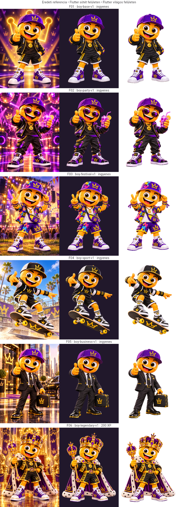
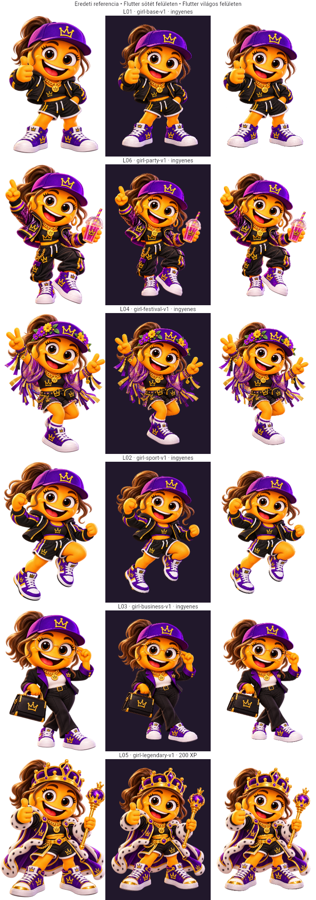
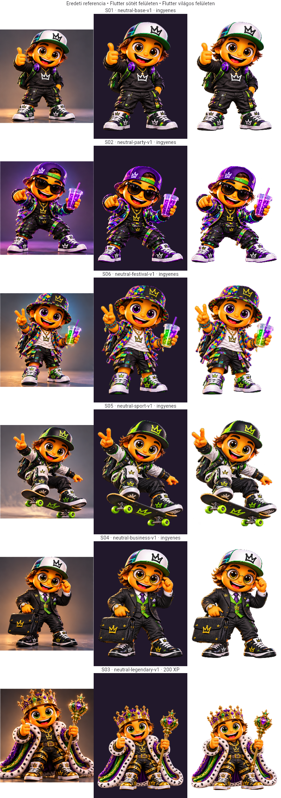

# Számozott Menti-leltár – tényleges katalógus

Az F/L/S besorolás a tulajdonos jelölése. A 18 eredeti változatlan a korábbi leltárban. Az eredeti kép jóváhagyása nem jelenti az AI-segített kivágás automatikus új jóváhagyását. A kivágások ellenőrizhető származtatott jelöltek; az alkalmazásban a külön fejlesztési ág kipróbálására szerepelnek.

Minden forrás és származtatott kép SHA-256 értéke: [catalog-provenance.json](catalog-provenance.json). Az eredeti/sötét/világos Flutter-képek soronként:

| Sorszám | Referencia | Család, stílus | Feltétel | Feldolgozás |
|---|---|---|---|---|
| 01 | F01 | Fiú · alap | ingyenes kezdő | referencia alapján kivágott származtatott jelölt |
| 02 | F02 | Fiú · buli | ingyenes kezdő | referencia alapján kivágott származtatott jelölt |
| 03 | F03 | Fiú · fesztivál | ingyenes kezdő | referencia alapján kivágott származtatott jelölt |
| 04 | F04 | Fiú · sport | ingyenes kezdő | referencia alapján kivágott származtatott jelölt |
| 05 | F05 | Fiú · üzleti | ingyenes kezdő | referencia alapján kivágott származtatott jelölt |
| 06 | F06 | Fiú · legendás | 200 XP, végleges | referencia alapján kivágott származtatott jelölt |
| 07 | L01 | Lány · alap | ingyenes kezdő | eredeti RGBA, bájtpontos |
| 08 | L06 | Lány · buli | ingyenes kezdő | eredeti RGBA, bájtpontos |
| 09 | L04 | Lány · fesztivál | ingyenes kezdő | eredeti RGBA, bájtpontos |
| 10 | L02 | Lány · sport | ingyenes kezdő | eredeti RGBA, bájtpontos |
| 11 | L03 | Lány · üzleti | ingyenes kezdő | eredeti RGBA, bájtpontos |
| 12 | L05 | Lány · legendás | 200 XP, végleges | eredeti RGBA, bájtpontos |
| 13 | S01 | Semleges · alap | ingyenes kezdő | referencia alapján kivágott származtatott jelölt |
| 14 | S02 | Semleges · buli | ingyenes kezdő | referencia alapján kivágott származtatott jelölt |
| 15 | S06 | Semleges · fesztivál | ingyenes kezdő | referencia alapján kivágott származtatott jelölt |
| 16 | S05 | Semleges · sport | ingyenes kezdő | referencia alapján kivágott származtatott jelölt |
| 17 | S04 | Semleges · üzleti | ingyenes kezdő | referencia alapján kivágott származtatott jelölt |
| 18 | S03 | Semleges · legendás | 200 XP, végleges | referencia alapján kivágott származtatott jelölt |

## Tényleges grafikai ellenőrzés

Mind a 18 konfiguráció: eredetihez viszonyított arc/haj/fejfedő; teljes ruha; csukló/kéz és tartott tárgy; cipő, köpeny/gördeszka/táska; világos és sötét felület; közös talpvonal; bélyegkép. A lány változatok mind bájtpontos eredeti átlátszó források. Az alap három korábbi asset változatlan. A többi fiú és semleges kép technikai, AI-segített háttérleválasztás; apró textúra/kontúr eltérés lehetséges, nem állítunk pixelazonosságot.

Hiányzó katalóguselem: nincs; 15 külön ingyenes és 3 tényleges XP-s kép van. Tulajdonosi vizuális elfogadás még szükséges a származtatott kivágások véglegesítéséhez. Nincs háttérválasztó vagy egymástól eltérő alapháttér. A leltár sötét/világos lapjai ellenőrző felületek, nem választható karakterhátterek.
