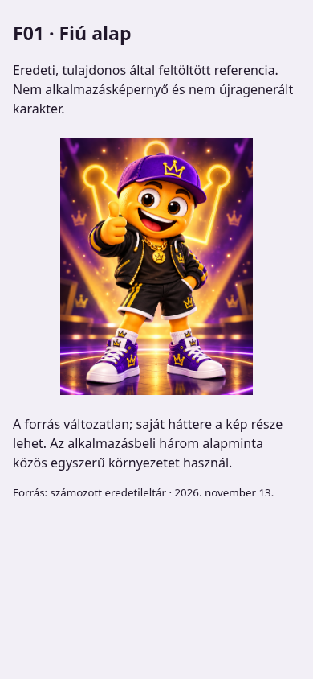
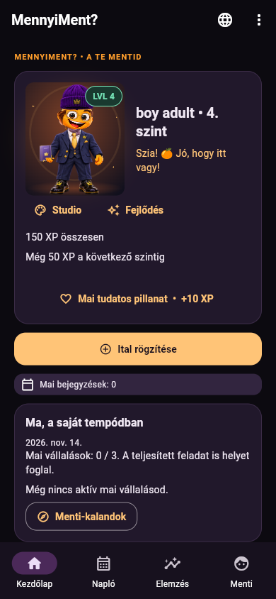
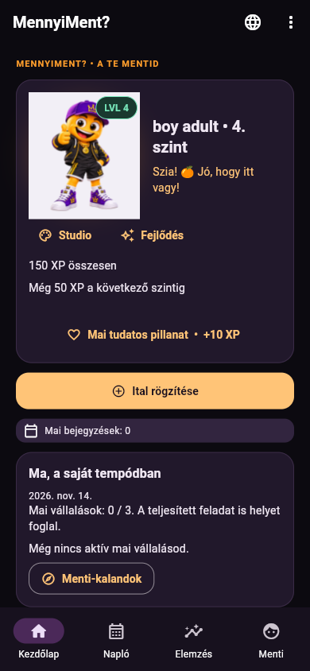
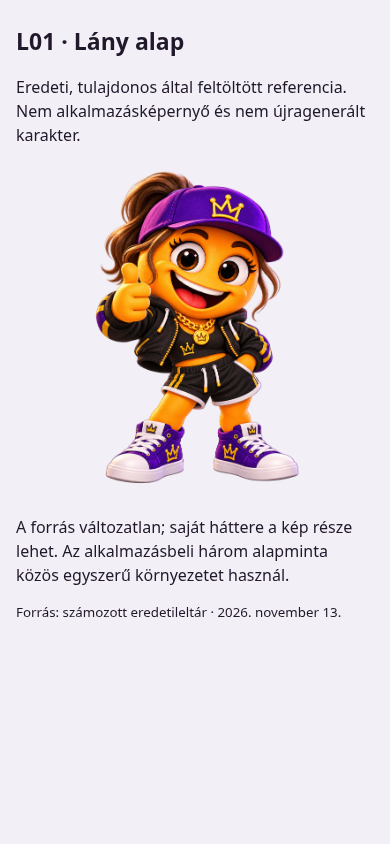
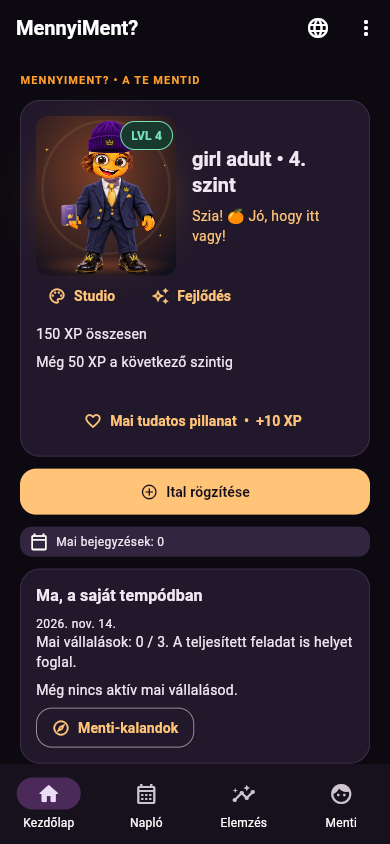
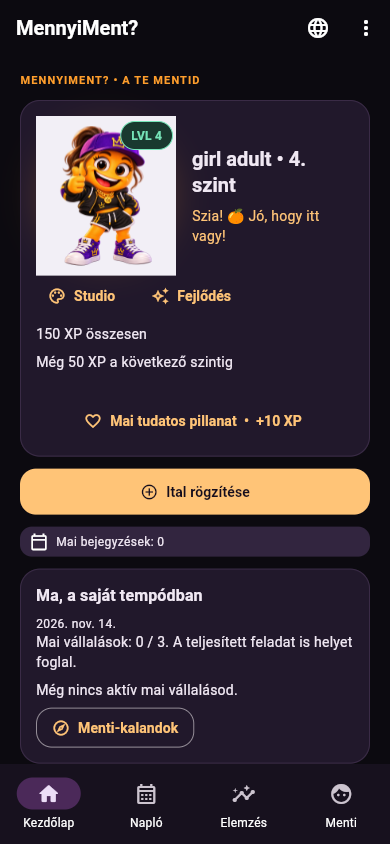
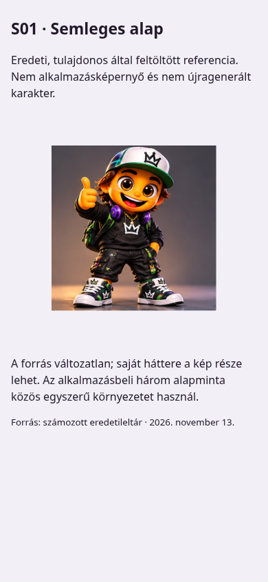
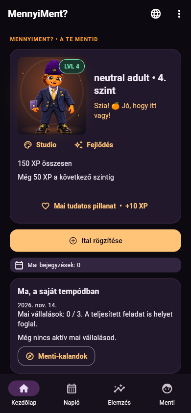
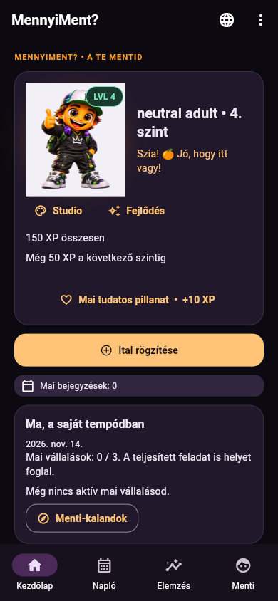

# Menti – eredeti, korábbi és új megjelenítés

Új alkalmazásforrás: `592d49a9a66c32ae1a10c60f66899bb4fa767636`, 2.5.0+37. Régi alkalmazásforrás: `3df8f66c7be59a92314694f738753ce9cc8755e7`, 2.4.1+36. A felvételek 2026. november 14-én, Chrome-ban készültek, **390×844 px** méretben, azonos szintetikus profiladatokkal.

Az első oszlop eredeti referencia, nem alkalmazásképernyő. A régi megjelenítés a business/beanie/scarf összeállítást, az új a teljes alapkinézetet mutatja. A régi ruhát nem alakítottuk át; külön, veszteség nélkül visszakapcsolható. Az új látvány tulajdonosi értékelésre vár.

| Család | 1. Eredeti referencia | 2. Korábbi 2.4.1 | 3. Új 2.5.0 |
| --- | --- | --- | --- |
| Fiú |  |  |  |
| Lány |  |  |  |
| Semleges |  |  |  |

[Önálló, letölthető képgaléria ZIP](../images/menti-complete-looks/comparison-592d49a.zip?raw=1). Kibontás után az `index.html` közvetlenül megnyitható: ez statikus képgaléria, nem a webalkalmazás. Tartalmazza a normál és nagyított képeket, a tényleges profil- és kalandképernyőket, a világos/sötét ellenőrzést, a HU/EN méretmátrixot, a változatlan natív alapreferenciákat és a SHA-256 jegyzéket.

[Magyar átadási jelentés](atadas-hu.md) · [Rövid kipróbálás](kiprobalas-hu.md) · [18 eredeti referencia leltára](referencialeltar-hu.md).
