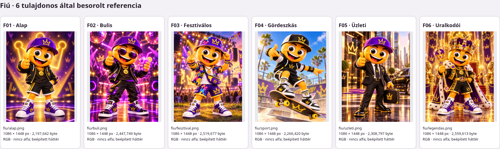
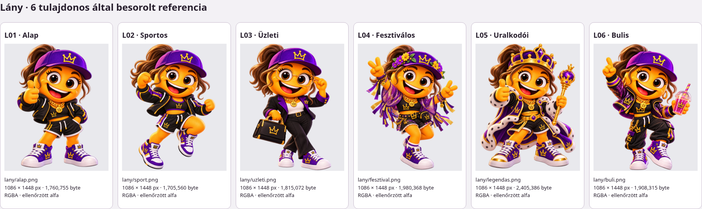
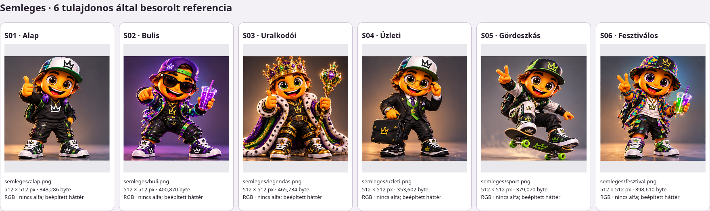

# Eredeti Menti-referenciák – első hozzárendelési leltár

Forrás: a tulajdonos ebben a beszélgetésben beillesztett képei. A családbesorolást a tulajdonos „fiú Menti”, „lány Menti” és „semleges Menti” megjelölése adja, nem fájlnév vagy külső megjelenésből levont feltételezés. Az alkalmazás korábbi renderjeit nem használjuk eredeti referenciaként.

**21 képbeillesztés, 18 azonosítható vizuális minta: 6 fiú, 6 lány, 6 semleges.** A kezdeti három alapképet a tulajdonos a családok megjelölésével később ismét elküldte. Az ismétlés vizuálisan megállapított kapcsolat; fájlszintű azonosságot még nem állítunk.

## Számozott hozzárendelés

A beillesztések számozása a beszélgetés sorrendjét követi: kezdeti három kép 01–03, fiú sorozat 04–09, lány sorozat 10–15, semleges sorozat 16–21. A külön F/L/S-azonosító a mintát jelöli, nem egy már létrehozott alkalmazásopciót.

| Minta | Beillesztés | Tulajdonosi besorolás | Az eredeti kép felismerhető részletei |
| --- | --- | --- | --- |
| F01 | 01, ismét 04 | Fiú | Lila koronás sapka, fekete–arany pulóver és rövidnadrág, aranylánc, feltartott hüvelykujj, világító koronás háttér. |
| F02 | 05 | Fiú | Lila lencsés napszemüveg, fényes fekete dzseki, hosszúnadrág, pohár, diszkófények. |
| F03 | 06 | Fiú | Festékfoltos kalap és rövid szett, keresztpántos övtáska, V-jel, szabadtéri fesztiválszínpad. |
| F04 | 07 | Fiú | Fekete–fehér sapka és sportos ruha, fekete–arany cipő, gördeszka sárga kerekekkel. |
| F05 | 08 | Fiú | Fekete öltöny és nyakkendő, lila sapka, koronás aktatáska, városi háttér. |
| F06 | 09 | Fiú | Ékköves korona, lila palást fehér szegéllyel, jogar, fekete–arany rövid szett, palotabelső. |
| L01 | 02, ismét 10 | Lány | Barna lófarok, lila koronás sapka, fekete–arany rövid szett és lánc, feltartott hüvelykujj. |
| L02 | 11 | Lány | Sportos fekete–lila rövid szett, két ököl, emelt térd, barna lófarok. |
| L03 | 12 | Lány | Aranykeretes szemüveg igazítása, fekete nadrágkosztüm lila hajtókával, fehér felső, koronás kézitáska. |
| L04 | 13 | Lány | Virágos lila sapka, lila–arany rojtos felső, rövidnadrág és övtáska, két V-jel. |
| L05 | 14 | Lány | Ékköves korona, lila palást fehér szegéllyel, jogar és feltartott hüvelykujj, lila–arany cipő. |
| L06 | 15 | Lány | Csillogó lila dzseki, fekete hosszúnadrág, karikafülbevaló, fedeles pohár és felemelt mutatóujj. |
| S01 | 03, ismét 21 | Semleges | Fehér–zöld koronás sapka, fekete pulóver fehér koronával, lila fejhallgató, hátizsák, zöld részletek, feltartott hüvelykujj. |
| S02 | 16 | Semleges | Hátrafordított lila–zöld sapka, sötét szemüveg, színes fényes dzseki, lila pohár és előremutató kéz. |
| S03 | 17 | Semleges | Arany korona színes kövekkel, lila–zöld palást fehér szegéllyel, jogar, fekete–arany öltözék. |
| S04 | 18 | Semleges | Fehér–zöld sapka, kerek szemüveg, zöld mellény és lila nyakkendő, koronás aktatáska. |
| S05 | 19 | Semleges | Fekete–zöld sapka, fekete–fehér sportos felső, gördeszka zöld kerekekkel, V-jel. |
| S06 | 20 | Semleges | Színes foltos kalap és ing, fehér felső, rövidnadrág, V-jel és színes pohár. |

## Eredeti fájlok és számozott képes leltár

A három RAR megérkezett és hibamentesen kibomlott: mindegyikben hat eredeti PNG van, összesen **28 216 526 byte**. Az eredeti útvonalak és fájlnevek megmaradtak. Nem használtunk korábbi alkalmazásrenderből kivágott vagy újragenerált helyettesítő képet.

- Fiú: 1086×1448 px, RGB, nincs alfa; a díszlet a forráskép része.
- Lány: 1086×1448 px, RGBA, tényleges 0–255 alfával.
- Semleges: 512×512 px, RGB, nincs alfa; a háttér a forráskép része.

[Offline megnyitható képes leltár](../images/menti-complete-looks/index.html) · [Eredeti fájlok, archívum- és képenkénti SHA-256, méretek, alfaadatok](../images/menti-complete-looks/reference-files.json)

A fenti kontaktlapok az eredeti PNG-k böngészős elrendezéséről készült képernyőképek, kívül elhelyezett sorszámokkal. Az eredeti fájlok képpontjai változatlanok. A 18 eredetit ténylegesen átnéztük: a tulajdonosi családmegjelölésekkel és az inline képekkel egyeznek. A böngészős leltárban mind a 18 kép betöltött, nincs futási hiba vagy külső kérés.

## Egységes alapháttér – új tulajdonosi pontosítás

F01, L01 és S01 alkalmazásbeli mintája **azonos, egyszerű háttéren** jelenjen meg. Egyedi hátterek és háttérválasztás most nem készülnek; ezek későbbi fejlesztések. Az eredeti leltár a forrásokat saját hátterükkel őrzi meg. A fiú és semleges alapkép hátterének eltávolítása külön származtatott fájlon történik, az arc és az arányok megőrzésével, megfelelő grafikai eszközzel; nincs régi renderes helyettesítés.

## Első három integrációs minta

A feladat első mérföldkövéhez F01, L01 és S01 az alapképek tervezett kiindulópontjai. Ez nem az új alkalmazásbeli megjelenítés tulajdonosi jóváhagyása. Az új teljes kinézet egyetlen karakterkép lesz, a környezet külön rétegen; a régi sapka-, szem-, száj- és ruharétegeket nem tesszük rá. A további 15 referencia most gyűjteményi alapanyag, nem további 15 legyártandó mintakinézet.
