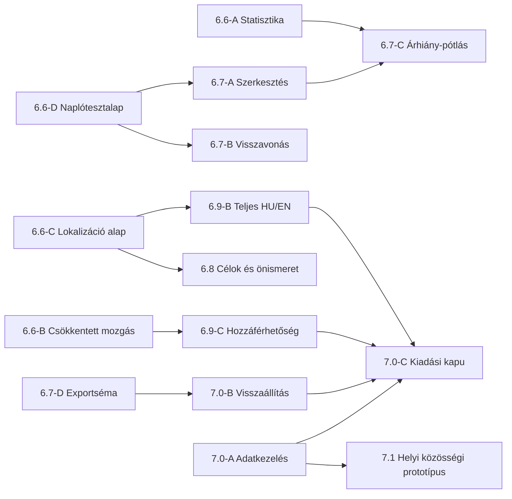

# MennyiMent? – állapotfelmérés és 6.6–7.1 fejlesztési terv

> A 6.7 csomagok új, felhasználó által kért sorrendje és pontos feladatkiírásai a [6.7-development-plan.md](6.7-development-plan.md) fájlban találhatók: A export/visszaállítási alap, B szerkesztő, C visszavonás, D költségkezelés. Ez a 6.7-es számozás felülírja az alábbi eredeti terv korábbi 6.7-es betűjelöléseit.

Felmérés: 2026. október 31. A terv a tényleges forráskód alapján készült, nem piackutatás vagy már megvalósított képességek ígérete. A verziószámok fejlesztési mérföldkövek; nem vállalt kiadási dátumok.

Kiindulópont: `main` commit `9457314c4d19bfd755b6ecf40c4652827bc1ee90`. A `v6.5-stable` annotált címke ugyanerre a commitra mutat. A címkét nem változtatjuk meg. Az alkalmazás `pubspec.yaml` verziója ettől függetlenül `1.0.0+1`, több képernyő szövegében régebbi fejlesztési verziószám látható; ezek nem jelentenek külön funkciókészletet.

## 1. A meglévő alkalmazás tényleges állapota

| Terület | Megvalósult, forrásból igazolt képesség | Hiány vagy következő kockázat |
| --- | --- | --- |
| Italnapló | Kategóriák és keresés, kedvencek, saját italok létrehozása/törlése; ml, alkoholfok és opcionális Ft-ár bevitele; meglévő ár szerkesztése, bejegyzés törlése megerősítéssel. [main.dart](../lib/main.dart), [drink_catalog.dart](../lib/drink_catalog.dart) | Teljes bejegyzésszerkesztés, múltbeli dátum/idő kényelmes kiválasztása és művelet-visszavonás nincs. A név/mennyiség/alkoholfok alapú kedvencazonosító átnevezéskor külön kompatibilitási tervet igényel. |
| Menti-profil | Három család × hat szett, stabil azonosítók és régi magyar megnevezések feloldása, gardrób, szinthez kötött elérhetőség, már kiválasztott ruha megőrzése. [menti_character_catalog.dart](../lib/menti_character_catalog.dart), [menti_profile_storage.dart](../lib/menti_profile_storage.dart), [menti_character_setup.dart](../lib/menti_character_setup.dart) | Teljes PNG-k, nem külön ruharétegek vagy valódi 3D-modellek. Néhány menthető megjelenési opció még nem változtatja meg a grafikát. |
| Közös megjelenítés | Mentett család és ruha a főoldalon, Studióban és fejlődési oldalon; mentés utáni frissítés, finom PNG-mozgás, dekódolási méretkorlát. [menti_evolution.dart](../lib/menti_evolution.dart), [avatar.dart](../lib/avatar.dart), [menti_progress.dart](../lib/menti_progress.dart) | Nincs minden szetthez külön arckifejezés-képkocka. A régi animációs és rajzolt modulok, valamint duplikált képmappák megmaradtak; törlésükhöz hivatkozási audit kell. |
| XP | Közös `MentiXpStore`; 50 XP-s szintlépés; napi önellenőrzés +10, heti naplóáttekintés +15, költésátgondolás +15, célkitűzés +20; napi/heti ismétlésvédelem. [menti_xp_store.dart](../lib/menti_xp_store.dart) | A történeti számlálók átfedése nem bizonyítható. Külön párhuzamos személyescél-önellenőrzés is létezik; nem szabad automatikusan XP-eseménnyé átalakítani. |
| Statisztika | Heti/havi/éves navigáció, ml és tiszta alkohol g-ban, grafikon, gyakori italok, napszakok; rögzítés nélküli nap megkülönböztetése az igazolt alkoholmentességtől. [statistics.dart](../lib/statistics.dart) | A 6.5 alapban időtartam-alapú naptárszámítás szerepel: óraátállításnál tesztelendő. A statisztikai olvasási modell még nem kap árat; költség itt nincs, más képernyőkön már van. |
| Pénzügyi áttekintés | Havi ismert költés és hiányzó árak, költségkeret, időarányos korábbi átlaghoz viszonyítás. [finance_center.dart](../lib/finance_center.dart), [dashboard_v2.dart](../lib/dashboard_v2.dart) | A külön képernyők számításai párhuzamosak. Hiányos árakból nem szabad teljes megtakarítást vagy keretteljesítést állítani. |
| Közérzet | Dátumhoz kötött hangulat 1–5, alvás 1–5, tünetek 0–4 és megjegyzés; korábbi nap frissítése/törlése, legutóbbi 60 bejegyzés megjelenítése. [wellbeing_journal.dart](../lib/wellbeing_journal.dart) | Nincs személyre szabott, önkéntes naplózási emlékeztető, adatkivitel vagy hozzáférésvédelem. |
| Összefüggések | Heti összevetés, költéskülönbség, italnap és következő napi közérzet párosítása; oksági és orvosi következtetések kizárása. [lifestyle_insights.dart](../lib/lifestyle_insights.dart), [menti_week_report.dart](../lib/menti_week_report.dart) | Kis mintából nincs megalapozott személyes következtetés; mintanagyság és hiányzó adatok egyértelműbb bemutatása indokolt. |
| Személyes célok | Heti költségkeret és önellenőrzési cél; saját napjelölések. [personal_goals.dart](../lib/personal_goals.dart) | Ezek külön napjelölései nem azonosak a közös XP-eseményekkel. Nincs visszaesést szégyenítés nélkül kezelő céltervező. |
| Megtakarítás | Célok, célösszeg, ténylegesen félretett pénz hozzáadása, cél törlése; 25/50/75/100%-os mérföldkövek. [savings_goals.dart](../lib/savings_goals.dart), [savings_milestones.dart](../lib/savings_milestones.dart) | A becsült költésváltozás és a ténylegesen félretett összeg fogalmát továbbra is külön kell kezelni. Nincs valódi pénzmozgatás. |
| Tárolás | Helyi `SharedPreferences`, elkülönített profilkulcsok, régi profilválasztások migrációja és ismeretlen értékek védelme. | Nincs fiók, felhőmentés, backend, bizonyított adatbázis-titkosítás vagy kész mentés-visszaállítás. A helyi tárolás önmagában nem jelenti a titkosítást vagy adatvesztéssel szembeni védelmet. |
| Nyelvek | Magyar feliratok, szövegek közvetlenül a widgetekben. | Nincs ARB-katalógus, `flutter_localizations` bekötés, angol nyelv és nyelvválasztó. A felhasználói nevek és tárolt azonosítók nem fordíthatók át. |
| Onboarding és akadálymentesség | Első karakterbeállító automatikus megnyitása; részleges szemantika és reszponzivitás. | Nincs külön, adatkezelést és adathiányt elmagyarázó onboarding; teljes képernyőolvasó-, nagybetűs és csökkentettmozgás-audit szükséges. |
| Közösség és monetizáció | A vizsgált függőségek és kód nem tartalmaznak hitelesítést, közösségi backendet vagy fizetést. | Barátok, csoportok, üzenetek, jelenlét és előfizetések későbbi, jóváhagyáshoz kötött munkák. |
| Kiadás | Flutter projekt webes és mobilplatform-mappákkal; 6.5-ben kódelemzés, 62 teszt és webes build ellenőrzött. [menti-6.5.md](menti-6.5.md) | Android `applicationId` még `com.example.mennyiment`, release build debug-aláírást használ; Play-kiadásra nem kész. Fizikai eszközös, böngészős E2E és store-adatbiztonsági ellenőrzés külön szükséges. [build.gradle.kts](../android/app/build.gradle.kts) |

### Megőrzendő adat- és termékszerződések

- Az alapvető italnapló, önellenőrzés, célok és saját adatokhoz való hozzáférés maradjon fizetés nélkül használható.
- XP csak a jelenleg engedélyezett önreflexiós eseményekért jár; elfogyasztott ital, magasabb mennyiség vagy költés nem jutalmazható. Új jutalmazási szabály külön termékdöntés.
- „Nincs naplóbejegyzés” nem egyenlő „biztosan alkoholmentes nap”; hiányzó ár nem 0 Ft; költéscsökkenés nem igazolt félretett pénz.
- A napló nem becsül vezetési alkalmasságot, biztonságos fogyasztási mennyiséget vagy diagnózist. Az összefüggések leíró jellegűek.
- A `mennyiment_menti_style_v1` örökölt kulcsot és az újabb választásokat meg kell őrizni; ismeretlen adatot migráció nem írhat felül találgatással.
- A történeti XP-kulcsok új összevonása jóváhagyásra vár. A 6.6–7.1 terv önmagában nem engedélyez új XP-migrációt.
- Éles backend, nyilvános közösségi felület és fizetési integráció külön jóváhagyás nélkül nem indul. Grafikai fájlt nem írunk felül.

## 2. Funkcióötletek és sorrend

Prioritás: P0 = megbízhatósági/alapfeltétel; P1 = következő értékes funkció; P2 = későbbi bővítés; P3 = kísérleti, döntést igényel. Nehézség: K = kicsi, M = közepes, N = nagy. Ezek relatív becslések, nem munkanap-vállalások.

Az ötletek a meglévő funkciókat konkrét új képességekkel egészítik ki; a már működő alap-kedvenceket, gardróbot vagy heti áttekintést nem számítjuk új ötletnek.

| # | Új képesség | Felhasználói előny | Nehézség | Szükséges technikai változtatás | Adatvédelmi/biztonsági kockázat | Prioritás |
| --- | --- | --- | --- | --- | --- | --- |
| 1 | Statisztikai ismert költés és árlefedettség minden időszakra | A mennyiséget és költséget egy helyen látja; tudja, ha az összeg részleges. | K | Opcionális ár a statisztikai olvasási modellbe, tiszta összesítő, UI. | Helyi pénzügyi adat; nincs továbbítás. | P1, 6.6-A |
| 2 | Naptárhelyes időszakok és adatminőségi jelzés | Óraátállításnál és üres/jövőbeli időszaknál is érthető számokat kap. | M | Tiszta dátumhatár-számítás, befagyasztható óra a tesztekhez. | Hibás nulla-nap állítás kerülendő. | P0, 6.6-A |
| 3 | Teljes italbejegyzés-szerkesztő dátummal és idővel | Később is pontosíthatja a tegnapi bejegyzést, újrarögzítés nélkül. | M | Szerkesztőlap, validáció, régi JSON-kompatibilitás, stabil bejegyzésazonosító-terv. | Előzmények véletlen felülírása; visszaállítható művelet kell. | P1 |
| 4 | Törlés visszavonása | Egy rossz koppintás nem okoz azonnali adatvesztést. | K/M | Visszavonási művelet, listapozíció és mentés összehangolása. | Tévesen „töröltnek” hitt érzékeny adat; időkorlát és világos jelzés. | P1 |
| 5 | Hiányzó árak célzott pótlólistája | Nem kell egyenként megkeresni a hiányos bejegyzéseket. | M | Szűrt lista, biztonságos részleges szerkesztés, frissülő kimutatás. | Pénzügyi adatok megjelenése; nincs automatikus árkitalálás. | P1 |
| 6 | Előre megtervezett alkoholmentes nap és külön tényleges visszajelzés | A szándékot és az önbevallott eredményt is követheti. | M | Új opcionális napállapot, meglévő naplótól elválasztott modell. | Egészségi/szokásadat; hiányból nem következtetünk sikerre. | P1 |
| 7 | Nem büntető, személyes csökkentési terv | Kis lépéseket választhat sorozatvesztés miatti szégyenítés nélkül. | M | Saját heti cél és leíró visszatekintés, klinikai küszöb nélkül. | A cél nem egészségügyi ajánlás; jutalom ne függjön ivástól. | P1 |
| 8 | Opcionális kiváltóhelyzet-napló | Felismerheti, mely helyzetekben nehezebb tartani a saját tervet. | M | Helyi címkék és jegyzetek; aggregált megjelenítés. | Érzékeny szabad szöveg; alapból semmilyen megosztás. | P2 |
| 9 | Előre megírt „ha–akkor” önkontrollkártyák | Nehéz helyzetben gyorsan előveheti a saját alternatíváját. | K/M | Helyi kártyák, kedvencek, opcionális alkalmi emlékeztető. | Tartalom láthatósága értesítésben; rejtett alapértesítés kell. | P1 |
| 10 | Önkéntes, helyi naplózási emlékeztetők csendes idővel | Nem felejti el az önellenőrzést, és nem kap ivásra ösztönző üzenetet. | M | Értesítési absztrakció, időzóna, opt-in/opt-out, engedélykezelés. | Zárolt képernyőn érzékeny téma; semleges szöveg és alapból kikapcsolva. | P2 |
| 11 | Csökkentett mozgás és nyugodt Menti-mód | Mozgásérzékenység vagy gyengébb eszköz mellett is használható. | K/M | Közös animációkapcsoló, rendszerbeállítás tisztelete, szemantika. | Alacsony; hozzáférhetőségi preferencia helyben marad. | P1 |
| 12 | Érthető feloldási előnézet és jutalomnapló | Pontosan látja, miért és mikor válik elérhetővé egy elem. | M | Katalógus-metaadat és meglévő XP-eseményekből levezetett nézet. | Történeti eseményhiányból nem szabad jutalmat kitalálni. | P2 |
| 13 | Magyar–angol nyelvváltás és lokalizált szám/dátum | Mindkét nyelven következetesen használható alkalmazás. | N | Flutter lokalizáció, ARB-k, nyelvválasztó; tárolási ID-k változatlanok. | Fordítás ne módosítsa a felhasználói adatot vagy biztonsági jelentést. | P0 |
| 14 | Helyi, verziózott adatmentés és előnézetes visszaállítás | Eszközváltáskor megőrizheti naplóját; hibás fájlt nem importál vakon. | N | Export/import séma, validáció, ütközéskezelés, biztonsági másolat. | Export érzékeny; titkosítás és jelszókezelés külön tervezendő. | P0 |
| 15 | Opcionális alkalmazászár és semleges alkalmazásváltó-előnézet | Más nem lát bele véletlenül a szokás- és közérzetadatokba. | N | Platformos biometria/PIN és háttérben takarás; webes korlátok jelzése. | A helyi zár nem egyenlő adattitkosítással; hamis biztonságérzet kerülendő. | P1 |
| 16 | Összefüggéskártyák mintanagysággal és hiányjelzéssel | Nem tekint néhány napot biztos személyes szabálynak. | M | Páros adatok száma, lefedettség, leíró összehasonlítás, nincs diagnózis. | Egészségi adatból túlzó következtetés; nincs külső AI-feltöltés. | P1 |
| 17 | Felhasználó által indított, anonimizálható heti összefoglaló-kivitel | Saját döntése szerint megbeszélheti az adatait segítővel. | M | Helyi jelentés-előnézet, mezőválasztás, rendszermegosztó. | A címzett és megosztott mezők feletti kontroll kötelező. | P2 |
| 18 | Privát támogató kör meghívással és alapból zárt láthatósággal | Egy megbízható társ segítheti a saját célját. | N | Előbb csak prototípus és fenyegetési modell; később hitelesítés/ACL. | Zaklatás, adatfeltárás; tiltás/jelentés és külön backendjóváhagyás kell. | P3 |
| 19 | Időkorlátos, visszavonható jelenlétmegosztás | Saját döntése szerint jelezheti egy barátnak, hogy támogatást kér. | N | Lejáró jogosultság, egyértelmű leállítás, pontatlan hely alapértelmezés. | Nagyon magas: helyadat és kényszerítés; külön jóváhagyás, alapból kikapcsolva. | P3 |
| 20 | Prémium kozmetikai csomagok előnézete | Választható külsővel támogathatja az alkalmazást az önkontroll korlátozása nélkül. | N | Előbb entitlement-interfész és helyi mock; új grafika csak külön fájlokban. | Fizetés, kiskorúak, vásárlás-visszaállítás; éles integráció jóváhagyásra vár. | P3 |
| 21 | Helyi készülékteljesítményhez igazított Menti-részletesség | Régebbi telefonon is folyamatos marad a napló. | M | Képdekódolási cache-mérés, animációterhelés-profil és kézi beállítás. | Teljesítménymérés alapból helyi, nincs eszközazonosító-gyűjtés. | P2 |
| 22 | Érthető adatok és engedélyek központja | Megérti, mi marad helyben, mit exportált és milyen engedély él. | M | Tárolási áttekintés, export/másolat állapot, engedélyhivatkozások. | A törlés külön megerősített feladat; onboarding során nem törlünk adatot. | P0 |

## 3. Mérföldkövek 6.6–7.1

| Verzió | Cél és kis csomagok | Kilépési feltétel |
| --- | --- | --- |
| 6.6 | Megbízható önismereti alap: A statisztikai időszak és költség; B csökkentett mozgás; C lokalizáció technikai alap; D naplóbeviteli tesztalap. | A jelenlegi adatok változatlanok; naptár-/költséghatárok teszteltek; animáció kikapcsolható; HU/EN alapbekötés mentéskompatibilis. |
| 6.7 | Jobb italnapló és adatmegőrzés: teljes szerkesztés, visszavonás, hiányzó árak; export séma és import-előnézet. | Szerkesztés/törlés/újranyitás tesztelve; sérült mentés nem írhatja felül a helyi adatot. |
| 6.8 | Tudatos célok és önismeret: alkoholmentes nap önbevallás, csökkentési terv, kiváltóhelyzetek, adatlefedettséggel kísért összefüggések. | Nincs fogyasztási jutalom; minden következtetés a rögzített adatokhoz kötött; a párhuzamos önellenőrzések összevonása nélkül használható. |
| 6.9 | Menti és hozzáférhetőség: reakciószabályok, feloldási magyarázat, akadálymentesség, teljesítményprofil; HU/EN minden aktív képernyőn. | Mind a 18 kombináció azonos marad animáció alatt; képernyőolvasó/nagy betűméret és nyelvváltás tesztelt; grafika nincs felülírva. |
| 7.0 | Kiadási és adatvédelmi alap: onboarding, engedélyközpont, helyi védelem, export/import, Android release-előkészítés. | Android aláírás/applicationId és Play-adatbiztonság rendezett; fizikai eszközös teszt; nincs automatikus store-publikálás. |
| 7.1 | Jóváhagyott bővítések előkészítése: privát közösségi prototípus, monetizációs modell és mock jogosultságok, támogató jelentések. | Backend/fizetés/jelenlét csak külön jóváhagyással; addig kizárólag helyi mock és specifikáció. Alapfunkciók fizetés nélkül elérhetők. |

## 4. GitHub-issue jellegű, kis feladatcsomagok

Minden issue külön ágon és kis, célszerű commitokkal készül. `main` és a stabil címke nem írható közvetlenül. Az „önállóan indítható” nem jelenti azt, hogy minden későbbi, kapcsolódó issue is automatikusan engedélyezett.

### 6.6-A – Statisztikai időszakok és ismert költség, mostani első csomag

**Állapot: megvalósítva ezen a fejlesztési ágon.** A végleges teszt- és build-eredmények az első 6.6-os csomag külön átadási dokumentumában szerepelnek. Az alábbi többi issue tervezett munka.

- **Cél:** a heti/havi/éves statisztikában helyes naptári határok és csak olvasó árösszesítés.
- **Terjedelem:** a statisztikai olvasási modell opcionális ármezője; főoldali adatátadás; naptárhelyes időszak-/napszám-számítás; ismert összeg és hiányzó árak. Nincs tárolási séma-, XP-, függőség- vagy képfájl-változás.
- **Elfogadás:** ismert nulla ár megkülönböztetett az ismeretlentől; üres időszak, hónap-/évforduló és jövő kezelése tesztelt; a meglévő statisztikai navigáció és figyelmeztetések működnek.
- **Tesztek:** tiszta számítások és widgettesztek; teljes regresszió, analyze, diff-ellenőrzés, webes build.
- **Függőség:** nincs új előfeltétel a 6.5 felett. **Kockázat:** alacsony, adatok csak olvasva.

### 6.6-B – Csökkentett mozgás, új grafika nélkül

- **Cél:** `MentiEvolution` állóképes mód rendszeres mozgáscsökkentési kérés esetén és helyi felhasználói kapcsolóval.
- **Elfogadás:** állóképnél nincs folyamatos ticker; koppintás nem indít tiltott mozgást; profil/kép/szint változatlan; újranyitáskor megmarad a kézi választás; a rendszerbeállítás nem kerül figyelmen kívül.
- **Tesztek:** ticker/animáció-életciklus, dispose, mind a 18 kép, nyelvfüggetlen tárolási érték.
- **Függőség:** nincs 6.6-A-függés. **Kockázat:** alacsony/közepes.

### 6.6-C – HU/EN lokalizációs alap és beállítás

- **Cél:** támogatott Flutter-lokalizációs út, ARB-k, `hu`/`en`, helyi nyelvpreferencia és nyelvválasztó; elsőként a közös navigáció és statisztika.
- **Elfogadás:** mindkét nyelv fordul és navigálható; hiányzó kulcs buildhibát/ellenőrzést ad; dátum/szám formázás nyelvfüggő; a család- és ruhaazonosító, személyes név és JSON nem fordul át.
- **Tesztek:** mindkét locale widgetteszt, nyelvváltás és újraindítás, régi magyar profilok; függőség/lockfile változás csak szükséges SDK-lokalizációhoz.
- **Függőség:** nincs A/B-függés; ugyanazon `main.dart`-ot érintheti, integrációs sorrend szükséges. **Kockázat:** közepes.

### 6.6-D – Naplóadapterek és szerkesztési regressziós tesztek

- **Cél:** a jelenlegi adatsémát olvasó tesztfixture-k, hiányzó ár/0 ár/múltbeli dátum, UI-hibák vizsgálata.
- **Elfogadás:** a régi JSON byte-szintű újraírás nélkül beolvasható; új adatmodell még nincs élesítve.
- **Függőség:** nincs; előkészíti a 6.7-A-t. **Kockázat:** alacsony.

### 6.7-A – Teljes bejegyzésszerkesztő

- **Cél:** név, ml, alkoholfok, ár, dátum és idő szerkesztése megerősített mentéssel.
- **Elfogadás:** megszakítás nem ír adatot; hibás/jövőbeli érték szabálya egyértelmű; azonos időpontú külön italok nem keverednek; régi JSON beolvasható; minden kimutatás frissül.
- **Függőség:** 6.6-D; stabil bejegyzésazonosító-migráció külön felülvizsgálata. **Tesztek:** létrehozás/szerkesztés/megszakítás/újraindítás.

### 6.7-B – Visszavonható törlés

- **Cél:** törlés utáni időkorlátos visszavonás, az eredeti rekord és sorrend megőrzésével.
- **Elfogadás:** egyszeri visszavonás, appháttér és gyors ismételt műveletek nem duplikálnak; lezárt törlés állapota érthető.
- **Függőség:** 6.6-D és azonosító-stratégia; 6.7-A-val integrációs szerződés.

### 6.7-C – Hiányzóár-pótló nézet

- **Cél:** csak ismeretlen árú bejegyzések listája és pontos szerkesztési célpontok.
- **Elfogadás:** 0 Ft nem kerül a listába; árpótlás után összesítések frissülnek; nincs automatikus árbecslés.
- **Függőség:** 6.7-A szerkesztési művelet, 6.6-A aggregáció.

### 6.7-D – Verziózott mentési formátum és export-előnézet

- **Cél:** dokumentált JSON-séma, felhasználó által indított helyi export, mezőlista és érzékeny tartalom jelzése.
- **Elfogadás:** minden aktív profil-/napló-/célkulcs felmérve; kulcsértékek nem kerülnek debuglogba; export semmit nem töröl.
- **Függőség:** adatkulcs-audit; nem igényel backendet. Visszaállítás csak 7.0-B után.

### 6.8-A – Tervezett és önbevallott alkoholmentes napok

- **Cél:** külön opcionális napállapot a szándékhoz és tényleges visszajelzéshez.
- **Elfogadás:** naplóhiány nem lesz automatikus megerősítés; italrögzítés és napállapot-ellentmondás érthető; nincs XP-szabályváltozás.
- **Függőség:** 6.6-D és stabil naptári segédfüggvények. **Tesztek:** konfliktus, időzóna/napváltás, módosítás.

### 6.8-B – Személyes csökkentési terv és ha–akkor kártyák

- **Cél:** felhasználó által választott kis lépések, alternatívák és rugalmas heti visszatekintés.
- **Elfogadás:** nincs fogyasztási verseny vagy büntető sorozatvesztés; alapfunkció ingyenes; cél nem klinikai ajánlás.
- **Függőség:** 6.6-C szövegkezelés; nincs függés új XP-migrációtól.

### 6.8-C – Helyi kiváltóhelyzet-címkék

- **Cél:** opcionális, saját címkék és helyi aggregáció; nincs automatikus helyadatgyűjtés.
- **Elfogadás:** címkék nélkül is teljes naplózás; export csak látható mezőválasztással; nincs háttérfeltöltés.
- **Függőség:** 6.7-A szerkesztési modell, 6.7-D séma.

### 6.8-D – Mintanagyságos összefüggéskártyák

- **Cél:** a meglévő ital–közérzet párok értelmezhetőségének javítása.
- **Elfogadás:** hiányzó adat nem nulla; a párok száma és adathiány megjelenik; kis minta esetén nincs kategorikus állítás; nincs diagnózis.
- **Függőség:** 6.6-C; közérzetmodell változatlanul olvasható. **Tesztek:** üres/kevés/ellentmondó minta, napváltás.

### 6.8-E – Opt-in helyi emlékeztetők

- **Cél:** önellenőrzési emlékeztető csendes idősávval, semleges üzenettel.
- **Elfogadás:** alapból kikapcsolva; engedélymegtagadásnál app működik; leállítás törli az ütemezést; nem küld ivásra hívó üzenetet.
- **Függőség:** 6.6-C, platformos értesítési megoldás értékelése; külön dependency-review.

### 6.9-A – Reakciók és feloldási magyarázat

- **Cél:** kontextushoz illő, nem ítélkező Menti-szövegek és a meglévő szintkövetelmények átlátható megjelenítése.
- **Elfogadás:** mind a 18 képnél identitás állandó; nincs fogyasztásért járó dicséret; történeti jutalom nem generálódik találgatással.
- **Függőség:** 6.6-B/C; új grafika nélkül is elkészíthető.

### 6.9-B – Teljes HU/EN képernyőlefedettség

- **Cél:** napló, gardrób, célok, közérzet, hibák és megerősítések ARB-be emelése.
- **Elfogadás:** mindkét nyelv teljes, tárolt magyar értékek továbbra is feloldhatók; hosszabb angol feliratok nem lógnak ki.
- **Függőség:** 6.6-C; képernyőnként külön PR.

### 6.9-C – Hozzáférhetőségi és teljesítménykapu

- **Cél:** képernyőolvasó, nagy betűméret, kontraszt, érintési célméret, kép-cache és animációterhelés mérése.
- **Elfogadás:** 360 pixeles és nagy kijelző, legalább 200%-os szövegméret; fő útvonalakon nincs overflow; mérési eszköz/platform és eredmény dokumentált, nincs személyes telemetria.
- **Függőség:** 6.6-B; a 6.9-B képernyőkkel párhuzamos auditálható.

### 7.0-A – Onboarding és adat-/engedélyközpont

- **Cél:** helyi tárolás korlátai, önbevallás, nyelv, önkéntes értesítés és adatkezelés megértése.
- **Elfogadás:** kihagyható nem kötelező lépések; nincs automatikus adattörlés; nincs rejtett opt-in; adatkezelési szöveg jogi felülvizsgálatra előkészítve.
- **Függőség:** 6.6-C és 6.7-D; jogi szöveg közzététele külön tulajdonosi döntés.

### 7.0-B – Biztonságos visszaállítás és alkalmazászár

- **Cél:** mentési fájl előnézete/validációja, felhasználó által jóváhagyott import, opcionális helyi zár.
- **Elfogadás:** rossz verzió/típus/túl nagy fájl elutasítva; jelenlegi adatokról visszaállítható másolat; import nem módosítja bizonytalan XP-t; zár nem állít nem létező titkosítást.
- **Függőség:** 6.7-D; titkosítás/PIN/biometria platformonként felülvizsgált terv. Külön kis PR: import-validátor, import UI, platformzár.

### 7.0-C – Android és Google Play kiadási előkészítés

- **Cél:** végleges alkalmazásazonosító, release-aláírás biztonságos konfigurációja, verzióstratégia, adatbiztonsági adatlap, store-anyagok.
- **Elfogadás:** nincs debug-aláírás a kiadási csatornában; kulcs nincs a repóban/chatben; AAB telepítés/indítás és adatfrissítési teszt fizikai eszközön; adatkezelési nyilatkozat megfelel a tényleges kódnak.
- **Függőség:** 6.9-B/C, 7.0-A/B; fejlesztői fiók, aláírási és jogi döntések a tulajdonostól. Kiadás/publikálás külön jóváhagyás.

### 7.1-A – Privát közösségi specifikáció és helyi prototípus

- **Cél:** profil, meghívás, tiltás/jelentés, csoporttagság, üzenet és adatmegőrzés modelljének tervezése.
- **Elfogadás:** nincs éles backend, valódi üzenetküldés vagy nyilvános profil; minden minta fiktív; alapból zárt láthatóság; moderáció és fenyegetési modell dokumentált.
- **Függőség:** 7.0-A; élesítéshez külön jóváhagyás, adatkezelői és üzemeltetési döntés kell.

### 7.1-B – Monetizációs terv és mock jogosultságok

- **Cél:** kozmetikai prémium és választható extra nézetek kipróbálható előnézete; alapnapló/önkontroll korlátozás nélkül.
- **Elfogadás:** nincs valódi terhelés vagy store-fizetés; elkülönített mock státusz; nincs megtévesztő előfizetési ígéret; entitlement-interfész tesztelt.
- **Függőség:** 6.9-A/B; éles fizetéshez külön jóváhagyás, store-szabályok és visszaállítási stratégia.

### 7.1-C – Felhasználó által indított jelentéskivitel

- **Cél:** anonimizálható, mezőválasztós heti jelentés előnézet és manuális megosztás.
- **Elfogadás:** nincs automatikus címzett/feltöltés; közérzet és megjegyzés külön kikapcsolható; a felhasználó látja a végső dokumentumot küldés előtt.
- **Függőség:** 6.8-D, 6.7-D; működhet teljesen helyben, közösségi backend nélkül.

### Külön zárolt döntések

- **XP-HISTORY:** régi XP-számlálók átfedése és esetleges magasabb régi érték vs v2 eltérés. Először csak olvasó diagnosztikai terv; nincs automatikus összegzés vagy korrekció. Elfogadási feltétele a tulajdonosi migrációs döntés és visszaállítási terv.
- **COMMUNITY-LIVE:** hitelesítési szolgáltató, régió, adattörlés, életkori korlátozás, moderáció, naplózás, költség és üzemeltetés. Jóváhagyás előtt nincs éles backend.
- **PRESENCE-LIVE:** helymeghatározás és időkorlátos önkéntes megosztás fenyegetési modellje. Jóváhagyás előtt nincs helyadatgyűjtés.
- **BILLING-LIVE:** előfizetési feltételek, jogosultság-visszaállítás, store-integráció, adatvédelem. Jóváhagyás előtt nincs valódi fizetés.

## 5. Függőségek és párhuzamosíthatóság

- **Párhuzamos terület 1:** 6.6-A tiszta statisztikai modell és tesztek.
- **Párhuzamos terület 2:** 6.6-B animáció és hozzáférhetőségi tesztek.
- **Párhuzamos terület 3:** 6.6-C szövegleltár/ARB és 6.6-D naplófixture-k. A `main.dart` éles bekötéseit sorban kell integrálni.
- **Párhuzamos terület 4:** 6.7-D adatséma-audit és 7.0-C kiadási checklist előkészítése, kód- és kulcsmódosítás nélkül.
- Két ágon ne induljon ugyanazon profil-/XP-migráció; integráció előtt aktuális `main`-re épülő diff- és regressziós ellenőrzés kell. Függő ágak sorrendjét a PR-leírás tartalmazza.

## 6. Általános ellenőrzési és átadási kapu

Minden csomaghoz a valódi viselkedést vizsgáló egység-/widgetteszt szükséges, meglévő adatfixture-kkel és regressziós ellenőrzéssel. Kötelező `flutter analyze`, `flutter test`, `git diff --check`; ahol elérhető, `flutter build web`. Tárolást érintő változásnál régi mentés, sérült adat, ismételt migráció és megszakított művelet tesztje is kell. Új függőség csak indoklással és rögzített lockfile-lal.

A teljesítmény- és mobileszközös állításokhoz tényleges mérést kell dokumentálni; a widgetteszt nem bizonyít fizikai eszközös működést. A webes build nem teljes böngészős E2E-teszt. Kiadási kapunál Android-eszköz és store-konfiguráció ellenőrzése külön szükséges.

A teszteredményeket az adott csomag átadási dokumentuma és PR-je rögzíti. A roadmap tervezett teszteket tartalmaz; nem állítja a még meg nem valósított csomagok sikerességét.

## 7. A következő három önállóan indítható feladat pontos kiírása

A mostani 6.6-A csomag után ezek egymástól függetlenül elkezdhetők. Az explicit napi állapot a 6.6-D tesztalap után következik a 6.8-A issue szerint.

1. **`#MOTION` / `feature/6.6-reduced-motion` – Csökkentett mozgás, a 6.6-B issue szerint.** Vizsgáld meg a `MentiEvolution` és rendszeres animációk életciklusát. Támogasd a rendszer mozgáscsökkentési kérését és egy helyi felhasználói beállítást. Ne változtasd meg a karakterképeket, profilkulcsokat vagy XP-t. **Elfogadás:** állóképes módban nincs folyamatos ticker; koppintás nem indít tiltott mozgást; rendszerbeállítás mellett a kézi kapcsoló nem kényszerít mozgást; a kép/szint változatlan; az explicit helyi választás újranyitáskor megmarad. Teszteld mind a 18 kombinációt, a visszakapcsolást és dispose-t; futtasd a teljes kaput és készíts külön PR-t.
2. **`#L10N` / `feature/6.6-localization-foundation` – HU/EN alap, a 6.6-C issue szerint.** Vezesd be a Flutter támogatott lokalizációját ARB-kkel és `hu`/`en` nyelvekkel. A navigációt, nyelvválasztót és statisztikát fordítsd le elsőként; ne állítsd, hogy a teljes app már angol. Tárolt ID-t, felhasználói nevet és régi magyar profilértéket ne írj át. **Elfogadás:** mindkét locale buildel; a választott nyelv újranyitáskor megmarad; hiányzó kulcs ellenőrizhető; hosszú angol szöveg nem lóg ki; a korábbi család/ruha mentések mindkét nyelven feloldhatók. Függőségváltozást külön indokold. Futtasd az analyze/test/diff/web kaput és készíts külön PR-t.
3. **`#LOG` / `test/6.6-diary-compatibility` – Italbevitel-validáció és regressziós tesztalap, a 6.6-D issue szerint.** Készíts régi napló-JSON fixture-ket null/0/ismert árral, azonos időpontú külön italokkal, dátumhatárokkal és hibás rekordokkal. Vizsgáld a jelenlegi ml/alkoholfok/ár beviteli határokat, vessző/pont tizedesek kezelését és a mentés megszakítását. **Elfogadás:** érvénytelen adat nem menthető; null ár nem alakul 0-vá; megszakításkor és dupla koppintáskor nincs véletlen bejegyzés; régi adatok betölthetők; árjavítás és törlési megerősítés regressziója tesztelt. Dokumentáld a stabil bejegyzésazonosítók későbbi követelményeit, de még ne migrálj és ne készíts új mentési rendszert. A feltárt kódhibákat külön kis commitban javítsd; teljes kapu és külön PR.
